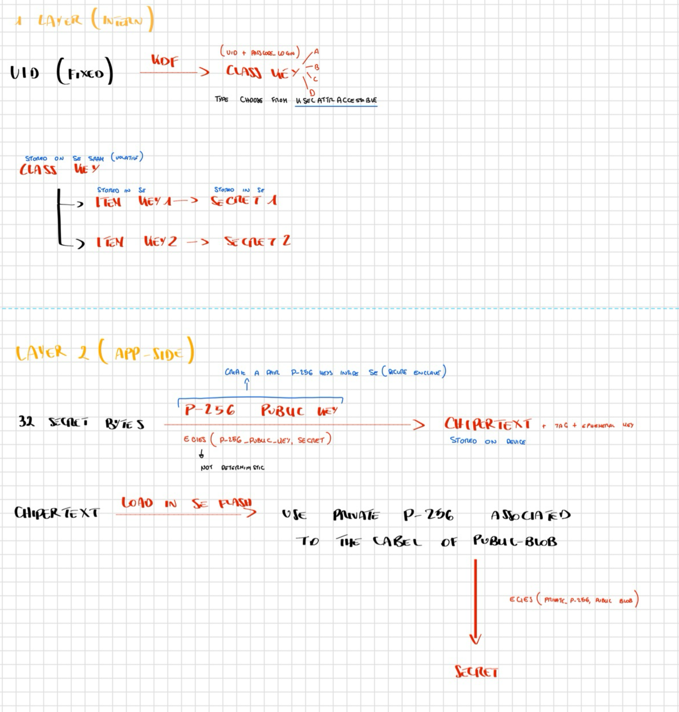
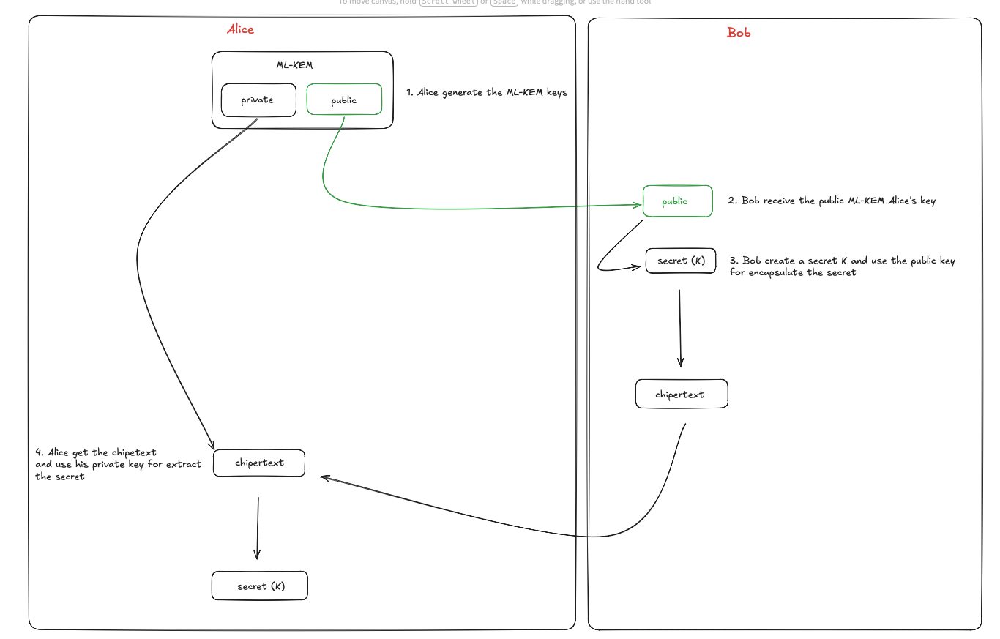
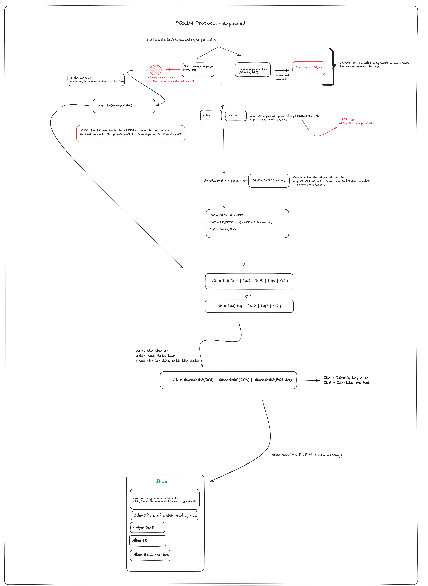
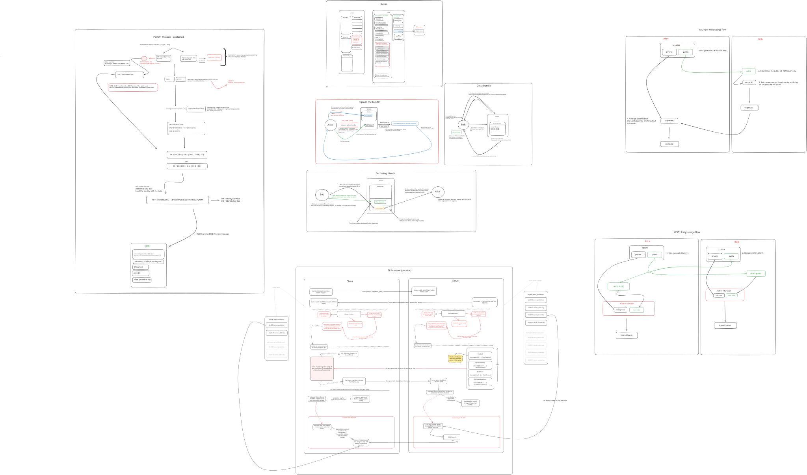

# ML-DSA Security Update

## Obiettivo della regressione

Questa regressione introduce un primo livello di hardening software per la gestione delle chiavi ML-DSA e dei materiali sensibili in RAM.

Il problema iniziale era che alcuni valori critici, tra cui `seed`, `eSeed`, `sSeed`, chiave privata e chiave pubblica, potevano restare in memoria ordinaria ed essere osservabili tramite dump della RAM. L'obiettivo non e rendere il sistema "impossibile da violare", ma ridurre in modo concreto l'esposizione dei dati sensibili e pulire la memoria appena possibile.

## Modifiche principali

### 1. Protezione dei buffer sensibili

Nel file [dilithium.go](/Users/massy/Desktop/P2Chat/cirl-custom/circl/sign/mldsa/mldsa87/internal/dilithium.go) alcune variabili sensibili non vengono piu gestite come semplici allocazioni ordinarie, ma tramite `memguard.LockedBuffer`.

Questo porta due benefici pratici:

- blocco delle pagine in RAM tramite `mlock`, per ridurre l'esposizione allo swapping;
- distruzione esplicita del contenuto tramite `Destroy()` quando il dato non serve piu.

I valori coinvolti includono in particolare:

- `seed`
- `eSeed`
- `sSeed`
- porzioni della chiave privata durante generazione e derivazione

### 2. Distruzione della chiave privata

La struct `PrivateKey` contiene ora un riferimento interno al buffer protetto:

```go
buf *memguard.LockedBuffer
```

Questo permette di associare la vita logica della chiave privata alla vita del buffer protetto e di distruggerlo esplicitamente tramite il metodo:

```go
func (sk *PrivateKey) Destroy()
```

In questo modo la chiave non resta in memoria oltre il necessario.

### 3. Rimozione del seed dalla struct

Per scelta progettuale, il seed originale non viene piu conservato nella struct della chiave privata.

La decisione ha un costo funzionale: non e piu possibile ricostruire o replicare la chiave a partire dal seed mantenuto in memoria.

Il vantaggio e che si riduce la superficie di attacco:

- meno dati sensibili persistenti nella struct;
- minore rischio di leak del seed;
- minore rischio di replica non autorizzata della chiave.

## Cifratura della chiave privata

La chiave privata viene protetta appena possibile dopo la generazione. Il flusso attuale e:

1. `password + salt -> Argon2id`
2. chiave derivata a 32 byte -> `AES-256`
3. cifratura della chiave privata con `AES-GCM`

Nel codice client questo passaggio e distribuito principalmente tra:

- [argon.go](/Users/massy/Desktop/P2Chat/cmd/client/internals/argon/argon.go)
- [aes256.go](/Users/massy/Desktop/P2Chat/cmd/client/internals/encryption/aes256.go)
- [encryptPrivateKeyMLDSA.go](/Users/massy/Desktop/P2Chat/cmd/client/internals/encryption/mldsa/encryptPrivateKeyMLDSA.go)
- [create_mldsa_keys.go](/Users/massy/Desktop/P2Chat/cmd/client/internals/keys/mldsa/create_mldsa_keys.go)

### Argon2id

Sono presenti tre livelli di costo per Argon2id. Il livello piu alto usa molta RAM ed e pensato per massimizzare la resistenza agli attacchi offline, ma ha un impatto prestazionale reale.

Questa scelta e sensata perche permette di bilanciare sicurezza e usabilita in base al contesto.

### Enclave in memoria

Nel flusso di decodifica e riapertura della chiave privata viene usato anche `memguard.Enclave`, che consente di mantenere il contenuto cifrato in memoria fino al momento dell'uso e di riaprirlo con `Open()` solo quando serve.

Questo e un buon compromesso per conservare temporaneamente materiale sensibile senza lasciarlo sempre disponibile in chiaro nello spazio di memoria del processo.

## Rischi residui

L'hardening introdotto migliora la situazione, ma non elimina ogni finestra di esposizione.

I rischi residui principali sono:

- la chiave derivata con Argon2id esiste comunque per un breve intervallo durante l'uso;
- il codice della libreria `circl` non e stato interamente riprogettato per la sicurezza della memoria;
- l'uso di `unsafe.Pointer` per costruire la `PrivateKey` richiede attenzione, anche se qui e una scelta intenzionale e limitata;
- `mlock` riduce il rischio di swapping, ma non basta da solo a dichiarare il sistema "immune ai dump" in senso assoluto.

In altre parole: il progetto e sensibilmente piu robusto di prima, ma non va descritto come impenetrabile. La formulazione corretta e che il rischio viene ridotto e circoscritto.

## Nota su `unsafe.Sizeof`

Nel punto seguente:

```go
sk1 := memguard.NewBuffer(int(unsafe.Sizeof(PrivateKey{})))
sk := (*PrivateKey)(unsafe.Pointer(&sk1.Bytes()[0]))
```

usare `PrivateKeySize` non sarebbe corretto, perche `PrivateKeySize` rappresenta la dimensione serializzata o packed della chiave, non la dimensione della struct Go completa in memoria.

L'uso di `int(unsafe.Sizeof(PrivateKey{}))` e quindi coerente con l'obiettivo di ospitare una `PrivateKey` intera nel buffer protetto.

## Watchdog

Il watchdog intercetta segnali di terminazione o fault e prova a pulire la memoria sensibile prima dell'uscita del processo.

Riferimento: [watchdog.go](/Users/massy/Desktop/P2Chat/cmd/client/internals/errors/watchdog.go)

L'idea e corretta: davanti a `SIGINT`, `SIGTERM`, `SIGSEGV` o `SIGBUS`, il processo riceve il segnale, invoca `memguard.Purge()` e termina con `os.Exit(1)`.

Va comunque tenuto presente che, nei crash piu violenti, non esiste garanzia assoluta che ogni cleanup applicativo riesca sempre a completarsi.

## Persistenza su file

Nel client, allo stato attuale del repository, le chiavi non sono ancora salvate entrambe come `.dat`:

- la chiave privata viene serializzata in protobuf e salvata come `SK.bin`;
- la chiave pubblica viene salvata come `PK.json`.

Riferimenti:

- [saving_mldsa_keys.go](/Users/massy/Desktop/P2Chat/cmd/client/internals/datacontrol/mldsa/saving_mldsa_keys.go)
- [mldsa.proto](/Users/massy/Desktop/P2Chat/cmd/client/internals/proto/mldsa/mldsa.proto)

Nel payload della chiave privata sono gia presenti metadati utili come:

- algoritmo
- parametri Argon2
- `salt`
- `nonce`
- magic byte di versione
- timestamp

La chiave pubblica, essendo pubblica, non richiede cifratura. Tenerla in chiaro evita costo computazionale inutile.

## Organizzazione del codice

La frammentazione dell'ex file `IK.go` in moduli distinti e una scelta buona e gia giustificata dal repository attuale. Le aree oggi risultano separate in modo piu leggibile:

- Argon2
- AES-256
- key management
- data control

I vantaggi pratici sono reali:

- ricerca dei problemi piu rapida;
- file piu piccoli e leggibili;
- test piu semplici da scrivere e mantenere.

## Test presenti

Nel repository sono gia presenti test utili su:

- cifratura e decifratura AES: [encryption_test.go](/Users/massy/Desktop/P2Chat/cmd/client/internals/encryption/encryption_test.go)
- comportamento con password errata: [encryption_test.go](/Users/massy/Desktop/P2Chat/cmd/client/internals/encryption/encryption_test.go)
- fuzz test su encrypt/decrypt: [encryption_test.go](/Users/massy/Desktop/P2Chat/cmd/client/internals/encryption/encryption_test.go)
- scrittura e lettura delle chiavi su file: [saving_mldsa_keys_test.go](/Users/massy/Desktop/P2Chat/cmd/client/internals/datacontrol/mldsa/saving_mldsa_keys_test.go)

Questa base e gia buona per evitare di costruire il progetto sopra primitive non verificate.

## Bug corretto durante i test

Durante i test e emerso un bug importante: usare direttamente il risultato di `aesKey.Bytes()` e poi chiamare `memguard.WipeBytes()` sullo slice porta a cancellare anche il contenuto protetto referenziato dal buffer originale.

In pratica, questo pattern e pericoloso:

```go
password := aesKey.Bytes()
defer memguard.WipeBytes(password)
```

perche lo slice restituito da `Bytes()` punta alla stessa area protetta.

La correzione concettualmente giusta e copiare prima i byte in uno slice separato e cancellare solo la copia temporanea:

```go
password := make([]byte, len(aesKey.Bytes()))
copy(password, aesKey.Bytes())
block, err := aes.NewCipher(password)
defer memguard.WipeBytes(password)
```

## Test argon e primi benchmark

mi sono accorto in seguito ai primi test che i parametri per argon erano davvero troppo elevati e impiegavano un livello di memoria superiore addirittura a 10Gb il che portava a tempi troppo elevati ma sopratutto avevo **invertito** i livelli di argon che ho aggiustato

i test che ho implementato sono su :
- casi limite di argon, tramite **table-driven**
- benchmark su alcune stringhe che permettono di capire piu o meno iterazioni e prestazioni dei vari livelli ( 1,2,3 )

### Test Argon
qui ho usato la funzione `run` che mi ha permesso di effettuare diversi test e capire quali passavano e quali no, molto utile e pratico nella realtà, inoltre confrontavo gli errori che ho inserito nella struct con quelli che argon mi dava realmente con determianti parametri input errati

### Benchmark Argon
usando sempre `run` ma anche `b.N` ho capito che GO usa quest'ultimo per capire quanti test continuare a fare finchè non ha una tempistica corretta per la quale poi può effettuare un test, precedentemente non andava in quanto b.N è impostato ad 1 secondo e se il test impiega meno fa una sorta di errore dove inserisce valori errati

per effettuare i test ho usato solo una stringa molto lunga come esempio in quanto variare con diverse stringhe può modificare la reale efficacia del test

ho variato i parametri e inoltre impostato il parametro `threads` usato per argon al numero di CPU che la macchina che usa il codice ha a disposizione


### Base testi vari 
ho chiesto a Codex di generarmi dei casi limite e verificare se gli errori venissero gestiti correttamente, in particolar modo sule seguenti funzioni :
- cifratura files e decifratura, verificata con diversi casi limite
- argon effettuati diversi test con casi limite
- datacontrol creati test con casi limite + eventuale scrittura di chiave con corruzione del file, verificato che il file non possa piu essere messo nel programma
  
## Test consigliati come prossimo passo

I prossimi test che hanno piu valore sono:

- usare un tipo diverso di cheksum, hash non basta in quanto una persona potrebbe modificare il tutto e successivamente ricreare il checksum
  
- controllare che quando vado a leggere le paia di chiavi queste siano un paio corretto ( usando una signature come prova )

### HMAC With Proto Structs - TPM

**problem** -> i cant be sure that a key is not compromised without a cypher but the problem is : **what key can i use to cipher these keys ?**
there are 2 solutions :
- use TPM ( interesting solution and best security level ) -> where the TPM store the password for the key and i use the HMAC func with the data key and the password
- use a password that choose the user but this would be have already 2 or more password ( 1 for Private Key encryption and 1 for hashing keys )


i choose ( for educative reasons ) to use the TPM but now i have a new idea, to generate inside the TPM the aesKey also for cipher the Private Key ml-dsa

with this choise the user can choose to :
- use an own password ( exposed temporary on ram ) for cipher the private key mldsa and the other keys 
- use the TPM for generate the keys and use a more secure system for store cipher keys
- is an user want we can combine password + TPM ( codex for merge functions )


### Implement TPM in cipher aes-256

the problem is that the keys mldsa and other keys that i want to use in my architecture are too big for let the TPM cipher so we need to change architecture

the main idea is :
- i request the TPM a small secret
- use the small secret with a KDF for derivation ( argon )
- use the derivation key for  cipher with AES-256

and i have already the main functions for do this job, now i have to implement :
- TPM managment ( linux, windows, apple )
- TPM creation key

then i will pass the secret to argon and then use aes256 for cipher the secret

**optional** -> add a function for merge the secret of user ( password ) with TPM secret


### Problems with this implemetation

i have multiple choises for implement the TPM in the application but all have some type of compromise

there are the ideas 

1. i can generate a secret inside the TPM and the use memguard for use the secret with AES 
    - benefit : super fast and not too much complex for now
    - problems : possible exposure in memory
2. create a Private and Public key inside the TPM for seal and unseal the secret with the cipher but
    - benefit : super secure
    - problems : problems with integrity ( TPM dont support GCM ) and i will need to chunk the secret because the keys are too big


for now i choose to implement the first so
1. generate the **root** secret inside the TPM
2. generate the HKDF with the secret and another secret inside the TPM
3. export the key and put it directly inside a memguard secure memory space ( critic phase )
4. use the key for aes cipher 

for now i think that is the most efficent and realistic architecture for implement in my application

TPM
├── root_key (non esportabile)
├── Derive(root_key, context) → session_key  [in TPM]
└── HMAC(data, root_key) → tag              [in TPM]

Memory (memguard)
└── session_key (solo durante uso)

Storage
├── encrypted_key = AES(session_key, plaintext_key)
└── tag = TPM_HMAC(encrypted_key, root_key)  ← integrity


### TPM implementation

but what is **TPM** ?

is a chip with RAM, NVRAM ( resist to reboot ), crittogrphic engine and PCR registers for sensibles operations
TPM store the keys like a tree

```
Owner Hierarchy (TPMRHOwner)
└── SRK - Storage Root Key
    ├── Chiave A (sealed)
    ├── Chiave B (sealed)
    └── Chiave C (sealed)
```

and everything is wrapped by the keys that are up the key itself

for create a secret inside the TPM we must use the ```tpm2.Create``` function that do :
- create some random bytes
- create the struct tpm2b_private 
``` 
type TPM2BPrivate struct {
    size   uint16  // lunghezza del buffer
    buffer []byte  // il contenuto cifrato
}
```
- cipher the key with the keys of his parents and with the SRK ( storage root key )
- cipher the TPM2BPrivate with the SRK
- return the 
  - OutPrivate -> the secret sealed with all the keys 
  - OutPublic -> metadata about the secret


then when i need to load the key i use ```tpm2.Load``` for :
- pass the OutPrivate and OutPublic
- decipher the key 
- load the key on the internal RAM
- return an **handle** like a refer ( not pointer ) to the specific internal area that contains the key
**IMPORTANT** the handle is NOT a pointer so i cannot access directly to the key in memory , i can only request to the TPM to access to the key

then when i'm done with the key i use ```tpm2.FlushContext``` to remove the key from the internal RAM of the TPM (the handle becomes invalid after this)

---

### TPM HMAC Key — the correct mechanism to export a secret

so far we have seen how the TPM creates and loads generic keys. now let's look at which key type to use for our specific case.

the key type we care about is a **HMAC key** (type `TPM_ALG_KEYEDHASH`). this is how it works:

```
TPM
└── HMAC key (TPM_ALG_KEYEDHASH)
        │   never exportable, never visible outside the TPM
        │
        TPM2_HMAC(handle, label) ← called by the application
        │
        ▼
    output: 32 bytes   ← the ONLY thing that leaves the TPM
```

the fundamental point is this: the **root key never touches the process RAM**. it does not exit during Load, it does not exit during HMAC. the only thing that exits is the HMAC result, which is already derived and reveals nothing about the original key material.

this is very different from "generate a secret and seal it", where the secret exists as plaintext at some point in its lifecycle. with a HMAC key, the raw cryptographic material never exists outside the chip.

#### `TPM2_HMAC` — what it does concretely

```go
// 1. load the HMAC key into TPM (from its sealed form on disk)
hmacHandle, err := tpm2.Load(tpmDev, srkHandle, outPrivate, outPublic)

// 2. the TPM runs HMAC internally using its own key
//    "mldsa-sk-v1" is the label that identifies the purpose (domain separation)
result, err := tpm2.HMAC(tpmDev, tpm2.TPMAlgSHA256, hmacHandle, []byte("mldsa-sk-v1"))

// result is 32 bytes — this is the only data that exits
// the HMAC key stays inside the TPM
```

the `label` matters: using different labels produces different outputs from the same root key. this is called **domain separation** and allows deriving multiple independent secrets without creating any dependency between them.

```
same HMAC key, different labels:

TPM2_HMAC("mldsa-sk-v1")   → secret_A   (protects ML-DSA SK)
TPM2_HMAC("mlkem-sk-v1")   → secret_B   (protects ML-KEM SK in the future)
TPM2_HMAC("integrity-v1")  → secret_C   (HMAC integrity tag for stored files)
```

all three are derived from the same root key but are fully independent.

---

### Dual Factor: TPM + Password — why it is not excessive

the question is legitimate: is adding the user password on top of the TPM secret really necessary?

**yes, it is the correct choice.** here is why.

the TPM secret alone protects against **software** attacks (RAM dumps, remote theft of the encrypted file), but not against **physical** attacks:

```
scenario without password:

attacker physically steals the laptop
    │
    ▼
removes disk, copies SK.bin
    │
    ▼
reinserts disk into the same laptop (the TPM is still there)
    │
    ▼
boots the system, requests the secret from the TPM
    │
    ▼
gets the keys  ← the TPM cannot distinguish the owner from the attacker
```

with password + TPM:

```
attacker steals the laptop
    │
    ├── has the physical TPM
    ├── has SK.bin
    └── does NOT have the password
            │
            ▼
        cannot derive the AES key
        cannot decrypt SK
```

the three required factors are:
1. **SK.bin file** on disk
2. **physical TPM** of the machine
3. **user password**

losing any one of them makes the keys permanently inaccessible.

---

### Creating a secret inside the TPM — full code walkthrough

This section shows the complete Go code to create a TPM-bound HMAC key and derive a secret from it. Every single line is explained.

The library used is `github.com/google/go-tpm/tpm2`, which is the standard Go library for TPM 2.0.

---

#### Step 1 — open the TPM device

```go
tpmDev, err := tpm2.OpenTPM("/dev/tpmrm0")
if err != nil {
    return nil, fmt.Errorf("cannot open TPM: %w", err)
}
defer tpmDev.Close()
```

- `tpm2.OpenTPM("/dev/tpmrm0")` opens a file descriptor to the TPM resource manager. On Linux the resource manager lives at `/dev/tpmrm0` and handles all context management automatically (flushing handles when the process exits, preventing handle exhaustion).
- `tpmDev` is just a file handle — not a pointer into TPM memory, just a channel to send commands.
- `defer tpmDev.Close()` closes the file descriptor when the function returns. This does NOT destroy any keys inside the TPM.

---

#### Step 2 — create the primary key (SRK equivalent)

But first, what is a **template**?
It is a way for the TPM to manage the secret associated with an instance of the template. The secret can be deterministic or non-deterministic depending on the key type.

The **primary key** associates a deterministic secret with the template, so every time we create the primary key from the same template on the same TPM, the secret is always the same.

The **child key** has a NON-deterministic secret, so every time we create an instance of the child key, the TPM generates a different secret.

```go
primaryTemplate := tpm2.Public{
    Type:       tpm2.AlgRSA,
    NameAlg:    tpm2.AlgSHA256,
    Attributes: tpm2.FlagStorageDefault,
    RSAParameters: &tpm2.RSAParams{
        Symmetric: &tpm2.SymScheme{
            Alg:     tpm2.AlgAES,
            KeyBits: 128, // AES-256 offers better quantum resistance, but AES-128 is already more than sufficient here since this key only protects internal child key blobs, not user data directly
        },
        KeyBits: 2048,
    },
}

primaryHandle, _, err := tpm2.CreatePrimary(
    tpmDev,             // the TPM file descriptor
    tpm2.HandleOwner,   // hierarchy: Owner (TPM_RH_OWNER)
    tpm2.PCRSelection{},// no PCR binding for now
    "",                 // hierarchy auth (empty = no password on hierarchy)
    "",                 // key auth (empty = no password on this key)
    primaryTemplate,    // the template that describes the key
)
if err != nil {
    return nil, fmt.Errorf("CreatePrimary failed: %w", err)
}
defer tpm2.FlushContext(tpmDev, primaryHandle)
```

`primaryTemplate` is the instruction set for the TPM describing how to create the key.

Note that the syntax `Type: tpm2.AlgRSA` is a composite literal — we assign to a struct field a constant value defined in the tpm2 library.

For example, `tpm2.AlgRSA` has the value `0x0001`, which is not just a library constant but a specific ID defined by the TPM 2.0 specification that tells the TPM to use the RSA algorithm to generate the key.

<br>

- `tpm2.Public` is the struct that describes what kind of key you want to create. It is the "blueprint" sent to the TPM.
It is called **public** because it represents the **public portion** of the key object in the TPM 2.0 protocol (corresponding to `TPMT_PUBLIC` in the spec). This is public in the cryptographic sense: it contains attributes, algorithms, and the key's *name* — information that can be shared safely. The private part (`TPM2B_PRIVATE`) is the sensitive area, encrypted inside the blob and never exposed.
- `Type: tpm2.AlgRSA` — this primary key is an RSA key. Its job is NOT to sign or encrypt your data directly. Its job is to **wrap and protect child keys** (like our HMAC key). This is why it needs to be a storage key.
- `NameAlg: tpm2.AlgSHA256` — the algorithm used to compute the key's "name" (a unique identity fingerprint of the key inside the TPM). SHA256 is the standard choice.
- `Attributes: tpm2.FlagStorageDefault` — marks this key as a **storage parent**: it can wrap and unwrap child keys. It cannot sign or decrypt user data directly.
- `RSAParameters.Symmetric` — defines how the sensitive area of child keys is encrypted when stored. AES-128 is the symmetric cipher used by the TPM to seal the child's secret material.
- `RSAParameters.KeyBits: 2048` — the RSA key size. 2048 bits is the TPM 2.0 standard for storage keys.
- `tpm2.CreatePrimary` sends all of this to the TPM. The TPM generates the SRK (Storage Root Key) deterministically from the hierarchy seed + template. This means: **calling CreatePrimary with the same template on the same TPM always produces the same key**. No blob needs to be saved to disk for the primary.
**IMPORTANT:** using the same template does NOT mean you can unwrap a secret on a different TPM. If you created the secret inside TPM A, only TPM A can unwrap it, because the key is derived from seeds that are physically bound to that specific chip and never leave it.
- `tpm2.HandleOwner` (= `TPM_RH_OWNER`) — the Owner hierarchy is the normal user-space hierarchy. There are three hierarchies (Owner, Endorsement, Platform). Owner is the right one for application keys.
- `tpm2.PCRSelection{}` — empty means we are NOT binding the key to any PCR values. If you provided PCR values here, the key could only be used when the platform is in a specific measured boot state.
**PCR** (Platform Configuration Registers) are special registers inside the TPM that record measurements of the machine's boot state.
- `primaryHandle` — the handle returned. It is a 32-bit integer that identifies a slot in the TPM's loaded-objects table in RAM. It is valid until you call `FlushContext` or close the device. **It is not a persistent value** — it only exists in the TPM's internal RAM for the duration of the session.
- `defer tpm2.FlushContext(tpmDev, primaryHandle)` — removes the primary key from the TPM's internal RAM when done. The key is NOT deleted — it can always be recreated deterministically. Flushing just frees the RAM slot.

---

#### Step 3 — define and create the HMAC key

```go
hmacTemplate := tpm2.Public{
    Type:    tpm2.AlgKeyedHash,
    NameAlg: tpm2.AlgSHA256,
    Attributes: tpm2.FlagFixedTPM |
                tpm2.FlagFixedParent |
                tpm2.FlagSensitiveDataOrigin |
                tpm2.FlagUserWithAuth |
                tpm2.FlagSign,
    KeyedHashParameters: &tpm2.KeyedHashParams{
        Alg:  tpm2.AlgHMAC,
        Hash: tpm2.AlgSHA256,
    },
}

private, public, err := tpm2.Create(
    tpmDev,             // TPM file descriptor
    primaryHandle,      // parent key that will seal this key
    tpm2.PCRSelection{},// no PCR binding
    "",                 // key auth password (empty for now)
    "",                 // sensitive data (not used here)
    hmacTemplate,       // blueprint for the HMAC key
)
if err != nil {
    return nil, fmt.Errorf("Create HMAC key failed: %w", err)
}
```

- `tpm2.AlgKeyedHash` — this is the TPM key type for HMAC and XOR operations. Unlike RSA or ECC, a KeyedHash key holds a symmetric secret (the HMAC key material) rather than an asymmetric keypair.
- `tpm2.FlagFixedTPM` — the key **cannot be duplicated** to another TPM. This is the flag that makes it hardware-bound: even if someone exports the sealed blob, it is useless on a different TPM.
- `tpm2.FlagFixedParent` — the key cannot be moved to a different parent inside the same TPM. It is permanently tied to `primaryHandle`.
- `tpm2.FlagSensitiveDataOrigin` — the key material was **generated by the TPM itself**, not imported from outside. This is the flag that guarantees the secret was born inside the chip.
- `tpm2.FlagUserWithAuth` — normal user-level authorization is sufficient to use this key (as opposed to requiring special admin-level auth).
- `tpm2.FlagSign` — this key is allowed to perform signing operations. For HMAC keys, "sign" means "compute HMAC". Without this flag the TPM would refuse HMAC requests.
- `KeyedHashParameters.Alg: tpm2.AlgHMAC` — specifies that this KeyedHash key does HMAC (not XOR).
- `KeyedHashParameters.Hash: tpm2.AlgSHA256` — HMAC-SHA256 specifically. The output will always be 32 bytes.
- `tpm2.Create` sends the template to the TPM. The TPM generates random key material internally and returns two blobs:
  - `private` — the key material **encrypted under the parent key** (primaryHandle). This blob is useless without the parent and without this specific TPM.
  - `public` — metadata about the key (type, algorithm, attributes, name). Not secret, but needed to reload the key later.
- **Important**: at this point the key is NOT loaded into the TPM's active RAM. It has been created and returned as sealed blobs. You must call `Load` before you can use it.

---

#### Step 4 — save the sealed blobs to disk

```go
// these two blobs must be persisted — they are needed every time you want to use the key
err = os.WriteFile("tpm_hmac_private.bin", private, 0600)
if err != nil {
    return nil, fmt.Errorf("cannot save private blob: %w", err)
}

err = os.WriteFile("tpm_hmac_public.bin", public, 0600)
if err != nil {
    return nil, fmt.Errorf("cannot save public blob: %w", err)
}
```

- `private` and `public` are just byte slices returned by `tpm2.Create`. They are safe to store on disk.
- `private` looks like random bytes to anyone who reads it — it is AES-encrypted by the parent key inside the TPM. Without the same TPM it is meaningless.
- `public` is readable metadata. It is not a secret but it is needed to reconstruct the key's name and verify integrity on Load.
- `0600` — file permissions: owner read/write only. This is the minimum correct permission for sensitive blobs.
- These two files together are the **persistent form of your HMAC key**. Every time the application starts it reads these, calls `Load`, gets a handle, and uses it.

---

#### Step 5 — load the key and get a usable handle

```go
// read blobs back from disk
private, err := os.ReadFile("tpm_hmac_private.bin")
if err != nil {
    return nil, fmt.Errorf("cannot read private blob: %w", err)
}
public, err := os.ReadFile("tpm_hmac_public.bin")
if err != nil {
    return nil, fmt.Errorf("cannot read public blob: %w", err)
}

// recreate the primary key (it is deterministic, no disk storage needed)
primaryHandle, _, err := tpm2.CreatePrimary(tpmDev, tpm2.HandleOwner, tpm2.PCRSelection{}, "", "", primaryTemplate)
if err != nil {
    return nil, fmt.Errorf("CreatePrimary failed: %w", err)
}
defer tpm2.FlushContext(tpmDev, primaryHandle)

// we pass the public and private blobs to Load, using the primaryHandle as parent, to get back the hmacHandle
hmacHandle, _, err := tpm2.Load(
    tpmDev,        // TPM file descriptor
    primaryHandle, // parent key — must be the same one that created this key
    "",            // parent key auth (empty, matches what we set at Create time)
    public,        // public blob from disk
    private,       // private blob from disk — the TPM decrypts this internally
)
if err != nil {
    return nil, fmt.Errorf("Load HMAC key failed: %w", err)
}
defer tpm2.FlushContext(tpmDev, hmacHandle)
```

- `tpm2.Load` takes the sealed blobs and asks the TPM to decrypt `private` using `primaryHandle`. The decrypted key material goes into the TPM's internal RAM (not your process RAM).
- The TPM verifies that the `public` blob is consistent with the decrypted `private` blob. If someone tampered with either blob on disk, `Load` fails here.
- `hmacHandle` — a new handle pointing to the now-loaded HMAC key inside the TPM. This handle is valid for the lifetime of the session.
- The primary key must be recreated with `CreatePrimary` before calling `Load` because a handle is just a reference to the TPM's internal RAM — it does not persist across sessions. `Load` then uses that handle as the parent to decrypt the private blob. Recreating the primary is instant and deterministic (same template = same key every time).

---

#### Step 6 — derive the secret with HMAC

```go
// label is a public domain-separation string — not a secret
label := []byte("mldsa-sk-v1")

// use the loaded hmacHandle to compute HMAC over the label — the key itself never leaves the TPM
result, err := tpm2.HMAC(
    tpmDev,             // TPM file descriptor
    tpm2.AlgSHA256,     // hash algorithm for HMAC-SHA256
    hmacHandle,         // handle to the loaded HMAC key inside the TPM
    label,              // the input data — your domain separation label
)
if err != nil {
    return nil, fmt.Errorf("TPM HMAC failed: %w", err)
}

// immediately move the result into protected memory
secret, err := memguard.NewBufferFromBytes(result)
if err != nil {
    return nil, fmt.Errorf("memguard failed: %w", err)
}
memguard.WipeBytes(result) // wipe the plain slice immediately after — result is the critical secret
```

- `tpm2.HMAC` **uses** the already-loaded key to compute a digest — it does not create anything. The TPM takes `hmacHandle` (the key in its internal RAM) and `label` (your input bytes) and computes `HMAC-SHA256(key, label)` entirely inside the chip.
- `result` is a plain `[]byte` of 32 bytes that arrives in your process RAM. This is the only moment the derived secret exists in regular memory, and it is the most critical value to protect.
- `label` is NOT a secret — it is a public domain-separation string that anyone can know. There is no need to protect it in memory.
- `memguard.NewBufferFromBytes(result)` copies those 32 bytes into a locked, mprotected memory region. From this point the secret is in protected RAM.
- `memguard.WipeBytes(result)` immediately zeroes the original plain slice. The window of exposure is a few microseconds between the HMAC call return and this wipe.
- The HMAC key itself never appeared in `result` — only the derived output did. Even if `result` were leaked, an attacker cannot reverse HMAC to recover the key.


<br>

### Summary

When we want to create a key inside the TPM we must define two types of template:
- **primary** → the SRK that will wrap the child
- **child** → the key we actually want to use

For example we define the primary template:
```
primaryTemplate := tpm2.Public{
    Type:       tpm2.AlgRSA,

    // the Name identifies the key uniquely inside the TPM
    // Name = ( AlgSHA256 || hash(TPMT_PUBLIC) )

    NameAlg:    tpm2.AlgSHA256,
    Attributes: tpm2.FlagStorageDefault, // can seal and unseal child keys
    
    // RSAParameters defines the properties of the RSA key object
    RSAParameters: &tpm2.RSAParams{

        // Symmetric defines the cipher used to encrypt the sensitive area of child keys
        Symmetric: &tpm2.SymScheme{
            Alg:     tpm2.AlgAES,
            KeyBits: 128,
        },
        KeyBits: 2048,
    },
}
```
The primary template uses 2 layers to protect the child:
- **AES (SymScheme)** encrypts the *sensitive area* of the child key — the actual secret material
- **RSA** wraps the AES key itself, binding the child to the parent through key wrapping

Then to instantiate this template and load the primary key into the TPM's RAM, we call `CreatePrimary`:

```
primaryHandle, _, err := tpm2.CreatePrimary(
    tpmDev,             // the TPM file descriptor
    tpm2.HandleOwner,   // hierarchy: Owner (TPM_RH_OWNER)
    tpm2.PCRSelection{},// no PCR binding for now
    "",                 // hierarchy auth (empty = no password on hierarchy)
    "",                 // key auth (empty = no password on this key)
    primaryTemplate,    // the template that describes the key
)
```

<br>
<br>

#### Generate the child key

Now we define the **child key**:
```
hmacTemplate := tpm2.Public{
    Type:    tpm2.AlgKeyedHash,
    NameAlg: tpm2.AlgSHA256,
    Attributes: tpm2.FlagFixedTPM |
                tpm2.FlagFixedParent |
                tpm2.FlagSensitiveDataOrigin |
                tpm2.FlagUserWithAuth |
                tpm2.FlagSign,
    KeyedHashParameters: &tpm2.KeyedHashParams{
        Alg:  tpm2.AlgHMAC,
        Hash: tpm2.AlgSHA256,
    },
}
```

`AlgKeyedHash` is a key type that holds a symmetric secret and can produce a keyed hash (HMAC) from it.
`KeyedHashParameters` defines the algorithm and hash function to use — in this case HMAC-SHA256.
The `Attributes` field defines security properties of the child key: hardware-binding, parent-binding, TPM-generated origin, and usage permissions.

<br>

#### Create the HMAC key

Now, with both templates defined, we create the **HMAC key** sealed under the primary:

```
private, public, err := tpm2.Create(
    tpmDev,             // TPM file descriptor
    primaryHandle,      // parent key that will seal this key
    tpm2.PCRSelection{},// no PCR binding
    "",                 // key auth password (empty for now)
    "",                 // sensitive data (not used here)
    hmacTemplate,       // blueprint for the HMAC key
)
```

In this function we pass:
- the path to the TPM resource manager
- the primary handle (SRK)
- the key auth password (controls who can use the key)
- the hmacTemplate (the blueprint for the child key)

**With this function the TPM creates the child key sealed under the primary.**

When `tpm2.Create` runs, the TPM internally generates:
- **public struct**: attributes and params
- **sensitive area**: the real secret material, not yet encrypted

Then from the **sensitive area** the TPM encrypts with the symmetric scheme (AES), binds it with the parent key (RSA wrapping), and adds integrity checks — this produces the **private blob**.

<br>

#### Load

`CreatePrimary` is called first to recreate the `primaryHandle` in the TPM's RAM (it is deterministic, so no disk storage is needed — a handle is a volatile RAM reference, not a persistent value). Then `Load` is called with the public and private blobs, using `primaryHandle` as the parent — the TPM decrypts the private blob internally and returns an `hmacHandle`. Finally `tpm2.HMAC` uses that handle to **compute** HMAC(key, label) and return the derived output.

#### Step 7 — flush and close

```go
tpm2.FlushContext(tpmDev, hmacHandle)
tpm2.FlushContext(tpmDev, primaryHandle)
tpmDev.Close()
```

- `FlushContext` removes the key from the TPM's internal RAM. the TPM has a very limited number of slots (typically 3). if you do not flush, subsequent Load calls may fail with `TPM_RC_OBJECT_MEMORY`.
- the key is NOT deleted — the sealed blobs on disk are unchanged. next time you need the secret you run the same Load → HMAC → FlushContext cycle.
- `tpmDev.Close()` closes the file descriptor. the `defer` statements placed earlier handle this automatically in the real code.

---

#### Complete picture — what lives where at each step

```
                      DISK                      TPM internal RAM          process RAM
                      ────                      ────────────────          ───────────
after Create:   tpm_hmac_private.bin      (nothing loaded yet)         (nothing)
                tpm_hmac_public.bin

after Load:     tpm_hmac_private.bin      primaryHandle → primary key  (nothing)
                tpm_hmac_public.bin       hmacHandle    → HMAC key

after HMAC:     tpm_hmac_private.bin      primaryHandle → primary key  result []byte  ← brief
                tpm_hmac_public.bin       hmacHandle    → HMAC key

after memguard: tpm_hmac_private.bin      primaryHandle → primary key  secret (mlock'd, mprotect'd)
                tpm_hmac_public.bin       hmacHandle    → HMAC key     result wiped

after Flush:    tpm_hmac_private.bin      (both handles flushed)       secret (mlock'd, mprotect'd)
                tpm_hmac_public.bin

```

the HMAC key material itself never appears in the "process RAM" column. only its 32-byte derived output does, and only briefly before memguard takes over.

---

## Implementazione TPM effettiva

### Architettura finale: Sealed Blob (non HMAC)

Dopo la fase di studio documentata sopra, l'architettura implementata si discosta dall'approccio HMAC descritto nelle sezioni precedenti. La scelta finale è il **sealed blob**:

- il TPM genera internamente un segreto casuale
- lo sigilla sotto la chiave primaria (blob cifrato, inutile su qualsiasi altro TPM)
- i due blob (`OutPrivate` + `OutPublic`) vengono salvati su disco
- quando il segreto serve, si chiama `Unseal`: il TPM disigilla e restituisce il segreto in RAM per un istante, poi `memguard` lo prende in carico

Rispetto all'approccio HMAC:

| aspetto | HMAC key | Sealed blob (scelto) |
|---|---|---|
| il segreto esce mai dalla RAM del TPM? | no (esce solo il derivato) | sì, brevemente durante Unseal |
| complessità | maggiore (label, domain separation) | minore |
| adatto alla fase attuale | no (over-engineering) | sì |

L'approccio HMAC rimane documentato in [`linux_legacy.go`](/Users/massy/Desktop/P2Chat/cmd/client/internals/tpm/linux_legacy.go) come riferimento commentato.

---

### Nuova API go-tpm (command-based)

Il codice legacy mostrato nelle sezioni precedenti usa la vecchia API procedurale di `go-tpm` (`tpm2.OpenTPM`, `tpm2.Create`, ecc.). L'implementazione reale usa la **nuova API command-based**:

```
libreria: github.com/google/go-tpm/tpm2
transport: github.com/google/go-tpm/tpm2/transport/linuxtpm
```

Il pattern cambia da:

```go
// vecchia API (legacy)
tpm2.CreatePrimary(tpmDev, tpm2.HandleOwner, ...)
```

a:

```go
// nuova API (command struct + Execute)
tpm2.CreatePrimary{
    PrimaryHandle: tpm2.TPMRHOwner,
    InPublic:      tpm2.New2B(primaryTemplate),
}.Execute(tpm)
```

**New2B** is a func that convert a normal declaration of the `primaryTemplate` in a TPM compatible struct

ogni comando è una struct con campi espliciti — più leggibile, più type-safe, allineato con la spec TPM 2.0.

un'altra differenza importante è `tpm2.NamedHandle`: nella nuova API, quando si passa un handle come parent a `Load`, bisogna passare anche il `Name` crittografico, non solo l'handle numerico. questo garantisce che il TPM verifichi l'identità del parent prima di procedere.

```go
parentHandle := tpm2.NamedHandle{
    Handle: primaryResp.ObjectHandle,
    Name:   primaryResp.Name,
}
```

---

### Primary template aggiornato

Il template nella nuova API specifica gli attributi e la modalità AES in modo esplicito:

```go
var primaryTemplate = tpm2.TPMTPublic{
    Type:    tpm2.TPMAlgRSA,
    NameAlg: tpm2.TPMAlgSHA256,
    ObjectAttributes: tpm2.TPMAObject{
        FixedTPM:            true,
        FixedParent:         true,
        SensitiveDataOrigin: true,
        UserWithAuth:        true,
        Restricted:          true,
        Decrypt:             true,
    },
    Parameters: tpm2.NewTPMUPublicParms(tpm2.TPMAlgRSA, &tpm2.TPMSRSAParms{
        Symmetric: tpm2.TPMTSymDefObject{
            Algorithm: tpm2.TPMAlgAES,
            KeyBits:   tpm2.NewTPMUSymKeyBits(tpm2.TPMAlgAES, tpm2.TPMKeyBits(128)),
            Mode:      tpm2.NewTPMUSymMode(tpm2.TPMAlgAES, tpm2.TPMAlgCFB), // CFB esplicito
        },
        Scheme:  tpm2.TPMTRSAScheme{Scheme: tpm2.TPMAlgNull},
        KeyBits: 2048,
    }),
}
```

il template è definito a livello di package (non di funzione) perché `CreateTPMResponse` e `UnsealSecret` devono usare **esattamente lo stesso template**: `CreatePrimary` è deterministico, stesso template + stesso TPM = stessa chiave. se i due template differissero anche di un bit, `Load` fallirebbe.

---

### Secret template: `TPMAlgNull` = sealed blob

Il template del segreto figlio usa `TPMAlgNull` come scheme:

```go
secretTemplate := tpm2.TPMTPublic{
    Type:    tpm2.TPMAlgKeyedHash,
    NameAlg: tpm2.TPMAlgSHA256,
    ObjectAttributes: tpm2.TPMAObject{
        FixedTPM:            true,
        FixedParent:         true,
        SensitiveDataOrigin: true,
        UserWithAuth:        true,
        // nota: niente FlagSign — non è una HMAC key
    },
    Parameters: tpm2.NewTPMUPublicParms(tpm2.TPMAlgKeyedHash, &tpm2.TPMSKeyedHashParms{
        Scheme: tpm2.TPMTKeyedHashScheme{Scheme: tpm2.TPMAlgNull}, // sealed blob, non HMAC
    }),
}
```

`TPMAlgNull` come scheme dice al TPM: questo oggetto non è una chiave operativa (non firma, non fa HMAC), è solo un contenitore di dati sigillati. il TPM genera il segreto casualmente internamente e lo sigilla — l'unica operazione permessa è `Unseal`.

---

### Funzioni implementate

Riferimento: [`linux.go`](/Users/massy/Desktop/P2Chat/cmd/client/internals/tpm/linux.go)

#### `AvailableTPM() bool`
controlla la presenza di `/dev/tpmrm0` (il TPM resource manager). restituisce `true` se il file esiste.

#### `StatusTPM() (bool, error)`
legge `/sys/class/tpm/tpm0/tpm_version_major` e verifica che la versione sia >= 2. restituisce `false` con errore se il TPM non è disponibile o la versione non è supportata.

#### `CreateTPMResponse() (*tpm2.CreateResponse, error)`
crea il sealed blob e restituisce la coppia `OutPrivate + OutPublic`. il segreto non esce dal TPM durante questa chiamata — esce solo come blob cifrato. il chiamante deve poi passare la risposta a `StoreBlobs`.

flusso interno:
1. apre `/dev/tpmrm0`
2. `CreatePrimary` con `primaryTemplate` → `primaryHandle`
3. `Create` con `secretTemplate` → `createResp` (contiene private e public blob)
4. `FlushContext` sul primary handle
5. restituisce `createResp`

#### `UnsealSecret(private TPM2BPrivate, public TPM2BPublic) (*memguard.LockedBuffer, error)`
ricrea la chiave primaria (deterministicamente), carica il blob figlio con `Load`, disigilla con `Unseal`, e immediatamente copia il segreto in un `memguard.LockedBuffer` (mlock). i byte grezzi vengono azzerati con `WipeBytes` prima di restituire.

```go
buf := memguard.NewBuffer(len(unsealResp.OutData.Buffer))
copy(buf.Bytes(), unsealResp.OutData.Buffer)
memguard.WipeBytes(unsealResp.OutData.Buffer) // azzeramento immediato
```

la finestra di esposizione in RAM ordinaria è la stessa pochi microsecondi tra `Unseal` e `WipeBytes`.

#### `StoreBlobs(private TPM2BPrivate, public TPM2BPublic) error`
serializza i blob con `tpm2.Marshal` (che produce il formato binario canonico TPM 2.0) e li salva su file tramite `datacontrol.SaveBytesOnFile`:

```
/data/blobs/privateBlob.bin  ← blob cifrato (inutile senza il TPM che l'ha creato)
/data/blobs/publicBlob.bin   ← metadati pubblici (necessari per Load)
```

---

### Flusso completo aggiornato (Sealed Blob)

```
                      DISK                      TPM internal RAM          process RAM
                      ────                      ────────────────          ───────────
after Create:   privateBlob.bin           (nothing loaded yet)          (nothing)
                publicBlob.bin

after Load:     privateBlob.bin           primaryHandle → primary key   (nothing)
                publicBlob.bin            childHandle   → sealed blob

after Unseal:   privateBlob.bin           primaryHandle → primary key   secret []byte  ← brevissimo
                publicBlob.bin            childHandle   → sealed blob

after memguard: privateBlob.bin           primaryHandle → primary key   secret (mlock'd)
                publicBlob.bin            childHandle   → sealed blob   raw bytes wiped

after Flush:    privateBlob.bin           (tutti gli handle flushed)    secret (mlock'd)
                publicBlob.bin
```

---

### Supporto multi-OS

| OS | stato |
|---|---|
| Linux | implementato (`linux.go`) |
| Windows | non ancora implementato (`windows.go` vuoto) |
| macOS | non ancora implementato (`macos.go` vuoto) |

macOS non ha un TPM standard (ha il Secure Enclave, ma con API completamente diverse). Windows ha un TPM accessibile tramite `tbs.dll` (TPM Base Services). entrambi sono lasciati come estensione futura.

---

### Rischi residui aggiornati (TPM)

- il segreto esiste in RAM ordinaria per un brevissimo intervallo tra `Unseal` e `memguard.WipeBytes` — finestra non eliminabile ma molto ristretta
- se il processo viene killato tra `Unseal` e `WipeBytes`, il segreto potrebbe restare in memoria — il watchdog con `memguard.Purge()` riduce questo rischio ma non lo elimina nei crash violenti
- i blob su disco (`privateBlob.bin`) sono inutili senza il TPM che li ha creati, ma la loro integrità non è verificata con HMAC — un attaccante che li corrompe causa un errore al `Load`, non una compromissione silenziosa
- il TPM da solo non protegge da un attaccante con accesso fisico al laptop acceso e al TPM non bloccato — combinare con password (come descritto nella sezione Dual Factor) rimane la scelta corretta

---

## TPM NV Optimization — persisting the primary key

### The problem: CreatePrimary is slow

Every time `CreateTPMResponse` or `UnsealSecret` ran, the first thing they did was call `CreatePrimary`. That command generates a fresh 2048-bit RSA key inside the TPM hardware — a real cryptographic operation happening on a small dedicated chip. Depending on the hardware, that is anywhere from 100ms to 500ms. Every. Single. Time the app touched the TPM.

For a one-off setup this is fine. But once the TPM becomes part of the normal startup flow (decrypt keys → unseal TPM secret → derive AES key → decrypt private key), that cost hits on every launch. It adds up fast and makes the app feel sluggish for no good reason.

### The fix: persist the primary key in NV memory

The TPM has a small area of non-volatile memory ( NV memory ) — think of it as a tiny internal hard drive that survives reboots and power-offs. You can move a transient key (one that lives only in the TPM's internal RAM) into that NV area using the `EvictControl` command, and assign it a **persistent handle**: a fixed 32-bit address you choose in the owner hierarchy range. We use `0x81000001`.

Once the primary key lives there, instead of running `CreatePrimary` every time, you just call `ReadPublic` on the persistent handle. `ReadPublic` is a trivial lookup — no cryptographic computation, no RSA keygen. The TPM just returns the key's metadata and its `Name` (a SHA256 hash that uniquely identifies the key and is used internally for cryptographic binding). Order of magnitude faster.
For `Unseal` the TPM doesn't need the **private key** stored in the TPM, it recalculate only the private key every time we call `Unseal` using the public key, the seed and the parameters 

### Why the sealed blobs stay valid on both paths

Here is the key insight: `CreatePrimary` in TPM2 is **deterministic**. Same template + same physical TPM chip = same key, always. Even after a reboot. Even if the key was flushed from internal RAM and recreated later from scratch. This is a fundamental TPM2 spec guarantee — the primary key is derived from seeds that are permanently burned into the chip and never leave it.

This means the `OutPrivate` + `OutPublic` blobs saved on disk are always valid, regardless of whether the parent was loaded from NV or freshly regenerated via `CreatePrimary`. The sealed child blob is bound to the key material, not to a specific session or handle. So:

- **NV fast path** (primary already persisted): `ReadPublic` → get `Name` → build `NamedHandle` → use as parent
- **CreatePrimary slow path** (first run, or NV not populated yet): generate the same key from scratch → use as parent

Both produce the exact same parent. `Load` and `Unseal` work correctly on both.

### The new function: `EnsurePrimaryNV`

```go
func EnsurePrimaryNV(tpm transport.TPM) (*tpm2.ReadPublicResponse, bool, error) {
    PublicRead, err := tpm2.ReadPublic{ObjectHandle: persistentHandle}.Execute(tpm)
    if err == nil {
        return PublicRead, true, nil
    }
    return nil, false, nil
}
```

Takes a `transport.TPM` connection from the caller (no internal connection opening — shares the caller's connection, single connection for the whole operation). Calls `ReadPublic` on `persistentHandle` for ensure that the **persistent handle** is not empty. If found, returns the full response — that is the Public Key including the `Name` needed to construct a valid `NamedHandle`. If not found, returns `nil, false, nil` — no error, just "not there".

So `PublicRead` is used effectly only for the parameter `Name` that allows the TPM to verify that `PublicRead` really corrispond to the **primary template**

The interface is `transport.TPM` (not `TPMCloser`) because `EnsurePrimaryNV` has no business closing the connection. The caller owns the lifecycle.

### How CreateTPMResponse and UnsealSecret use it

Both functions now follow the same pattern: open one connection, call `EnsurePrimaryNV` on it, branch on the result.

```go
tpm, err := linuxtpm.Open("/dev/tpmrm0")
// ...
defer tpm.Close()

// check if the NV contains something
pubResp, found, err := EnsurePrimaryNV(tpm)

if found && err == nil {
    
    // fast path: primary is in NV, skip CreatePrimary entirely
    parentHandle = tpm2.NamedHandle{
        Handle: persistentHandle,
        Name:   pubResp.Name,
    }
} else {
    
    // slow path: first run or NV not populated
    primaryResp, err := tpm2.CreatePrimary{...}.Execute(tpm)
    // ...
    parentHandle = tpm2.NamedHandle{
        Handle: primaryResp.ObjectHandle,
        Name:   primaryResp.Name,
    }
}
```

One connection, one `ReadPublic` call, no redundant operations. If `ReadPublic` fails (key not there), we fall back to `CreatePrimary` — same result, slightly slower, but correct.

**Note:** with the `EnsurePrimary` we check only if the TPM contains some primary template but doesnt check if the public key corrispond to the primary template, this check will do nextly in this part

```go
loadResp, err := tpm2.Load{
		ParentHandle: parentHandle,
		
		// load the blobs
		InPrivate: private,
		InPublic:  public,
	}.Execute(tpm)
	if err != nil {
		return nil, apperr.Wrap("Load failed", err)
	}
```

if the public key doesnt match the `Load` fail

### Before vs after

Before: every `CreateTPMResponse` or `UnsealSecret` call opened a connection and immediately ran `CreatePrimary` (RSA 2048-bit keygen on hardware).

After:
- first run ever: `CreatePrimary` once, then `EvictControl` stores the key in NV
- every subsequent run: `ReadPublic` on the persistent handle, no keygen at all

The security properties are unchanged. The NV-persisted primary key is the same key that `CreatePrimary` would have generated — it is just cached inside the chip instead of being regenerated each time. The sealed blobs on disk remain hardware-bound to this specific TPM and useless anywhere else.

### Performance Comparison

before the optimization the file `linux_tpm_test.go` did the test in about **15 second each time.**
With the new optimization, the first time is still 15 seconds BUT the other times that we want to create a new secret or `Unseal` a blob the function took only **0.4 seconds** in average, the function `BenchmarkCreateTPMResponse` do this comparison ( use -v option )
So the optimization improve the speed of the operation ( from the second time ) of **30 times faster** than the first one 

The test was conducted in this hardware
```
goos: linux
goarch: amd64
pkg: P2Chat/cmd/client/internals/tpm/linux
cpu: Intel(R) Core(TM) i5-7400 CPU @ 3.00GHz
BenchmarkCreateTPMResponse
```


### implementation of windows TPM interface
luckly windows and linux have the same interface for the managment of the TPM, except for the `openTPM` func that is defined in 2 files, infact linux use the library `linuxtpm` and windows `windowstpm` but the other **function** are the same

remark: the difference between `transport.TPM` and `transport.TPMCloser` is that the first is the **interface**, so declare how send messages to the TPM but cannot close the connetion the second is the interface + the method `Close()`/

# Implementation TPM ( Secure Enclave ) in MacOS

link : [Apple documentation about Secure Enclave](https://support.apple.com/guide/security/secure-enclave-sec59b0b31ff/web)

the Apple ecosystem does not have a standard TPM chip but uses a completely different security processor: the **Secure Enclave** (SE).
We access it through the **Security Framework**, a C library provided by Apple. because the framework is written in C and Go has no native bindings for it, we will use **CGo** that allows Go code to call C functions directly, compiled together inside the same binary.

**Remark** — unlike what you might expect, the SE *does* generate the P-256 private key entirely inside the chip using its hardware TRNG. what you generate yourself (with `crypto/rand`) is the **payload** you want to protect — for example, 32 bytes to use as an AES-256 key — and that payload is then encrypted *by* the SE key via ECIES. the SE private key never leaves the chip; only the ECIES-wrapped payload lives on disk. this is the fundamental architectural difference from the TPM sealed blob, where the secret itself is generated by the TPM and returned only through `Unseal`.

for this type of project i want to understand deeply how things work, so i will describe the main differences between the TPM and the SE (Secure Enclave) and why the SE is (in almost all circumstances involving a physical attacker) more secure than the TPM.

### Hardware differences

the Secure Enclave is **NOT** a separate chip like the TPM.

if we look at the motherboard of a Windows machine and an Apple device, the difference is immediately visible: the TPM is a discrete chip from a third-party vendor (Infineon, STMicroelectronics, Nuvoton) soldered on the PCB and wired to the CPU via a **SPI or LPC bus** — four physical traces you can probe. the SE, instead, is not a separate chip at all — it is a dedicated ARM processor die living inside the **same SoC package** as the CPU and GPU, with all its components physically isolated from the rest of the system at the silicon level.

it has its own independent SRAM, communicates with the application processor through a **hardware mailbox** system, and its memory is completely invisible to the rest of the chip. not even **root** can read inside the SE memory, because the firewall that enforces this isolation is hardwired into the silicon itself — it is not a software policy, not a kernel flag, not a configuration you can override. it is physical logic gates that implement one rule: only the SE processor can address its own SRAM. the main CPU's physical address space does not include the SE SRAM range at all. even a fully compromised kernel cannot map that memory, because the hardware address decoder simply does not route those requests to the SE.

communication between the main CPU and the SE does not happen over any external bus — it happens through an internal hardware mailbox, a small, strictly-controlled message-passing interface carved directly into the SoC interconnect fabric. this eliminates the entire class of **bus-sniffing attacks** that affect TPM systems.

the full communication stack, from your Go code down to the SE hardware, looks like this:

```
Go code (CGo)
    │
    ▼
Security.framework          (Apple C library — /System/Library/Frameworks/Security.framework)
    │
    ▼
secd                        (Security daemon — system process, not root, communicates via XPC)
    │
    ▼
AppleKeyStore.kext          (proprietary Apple kernel extension)
    │
    ▼
SE hardware mailbox         (internal SoC interconnect — no external bus, not sniffable)
    │
    ▼
sepOS                       (SE's own microkernel OS — immutable, verified at boot by Boot ROM)
```

compare this to the TPM communication stack on Linux:

```
Go code (go-tpm)
    │  builds binary TPM2 command packet (TCG spec — fully public and documented)
    ▼
/dev/tpmrm0                 (kernel character device — TPM resource manager)
    │
    ▼
tpm_tis_spi.ko              (kernel TPM driver — writes bytes to SPI via DMA)
    │
    ▼
SPI bus — 4 physical traces on the PCB   (sniffable but nowadays mitigated)
    │
    ▼
TPM chip                    (discrete microcontroller — Infineon, Nuvoton, etc.)
```

the TPM protocol is fully public (TCG TPM 2.0 Part 3 — Commands). the SE protocol between `AppleKeyStore.kext` and the SE hardware is completely proprietary — Apple does not publish it. you can only interact with the SE through the high-level Security.framework API; there is no `/dev/se` you can write raw commands to.


### UID Key
**the most exciting thing about the SE is the UID key** — the hardware root of trust for everything that happens inside the chip.

this key (256 bits) is generated by the **True Random Number Generator (TRNG)** built into the SE hardware. the TRNG is not a software algorithm — it is a hardware circuit that derives randomness from **thermal noise** (Johnson-Nyquist noise): the quantum-mechanically unpredictable fluctuation of electrons in a resistor caused by thermal agitation. the chip samples these voltage fluctuations at a fixed interval, runs the raw bit stream through a whitening/de-biasing conditioner to remove any statistical skew, and uses the result to generate the UID key the very first time power is applied to the chip. this value is then burned permanently into **OTP fuses** (One-Time Programmable) — a process that physically destroys specific fuse links by running a current pulse through them. once burned, the fuse state is irreversible at the silicon level.

nobody checks the uniqueness of this UID key, but the probabilistic argument makes the check unnecessary. with 256 bits and a high-quality hardware TRNG, the probability of any two Apple devices sharing the same UID key — computed via the birthday paradox over ~2 billion devices — is approximately **10⁻⁵⁹**. for reference, the probability of being struck by lightning is roughly **10⁻¹⁵**. the UID collision probability is **44 orders of magnitude smaller** than that. with numbers this extreme, explicit collision checking would be operationally meaningless.

the UID key is also never read out by anyone, during or after manufacturing. Apple's factory firmware burns it and receives only a "programmed successfully" status — never the value. not even Apple knows your device's UID key. this is by design: it allows Apple to legally and technically guarantee that they cannot decrypt user data even with physical possession of the device.


### Mailbox approach vs bus approach

the macOS kernel cannot read inside the SE memory even if fully compromised — the SE SRAM simply does not appear in the CPU's physical address space. the only communication path is the hardware mailbox, and the mailbox protocol only exposes pre-defined operations (generate key, sign, decrypt). there is no "dump SRAM" operation in the protocol.

the TPM, by contrast, uses a SPI bus where all message traffic — including the plaintext response from an `Unseal` command — travels over physical PCB traces. in 2021, Dolos Group demonstrated this attack in practice: they attached a cheap logic analyzer to the SPI bus, captured the TPM's `Unseal` response during Windows boot, and extracted the BitLocker Volume Master Key in plaintext. the TPM was working correctly and was not tampered with. the attack cost roughly $50 in hardware. (nowadays there are partial mitigations, like TPM + PIN, but the bus-level exposure is a structural property of any discrete TPM on a SPI bus.)

---

### Limitations and Software Differences

while the TPM is far more flexible and grants much more freedom in how an application can use it, the SE is very strict about what it allows.

for example, the TPM supports a wide range of key types: AES, HMAC (KeyedHash), EC P-256, RSA-2048, RSA-4096. the SE exposes only **EC P-256** as the key type generated and stored inside the chip. no RSA, no AES keys in hardware, no HMAC keys. the SE's internal AES engine does exist (sepOS uses it to encrypt P-256 keys at rest in Flash), but it is not accessible to applications through any public API.

the architectural differences go further:

- **no key hierarchy**: the TPM manages keys as a tree (Owner hierarchy → primary key → child keys), where every child is cryptographically bound to its parent through key wrapping. the SE has no hierarchy — each P-256 key is independent. there is no Storage Root Key concept, no parent-child binding.
- **no direct memory management**: with the TPM you control the key lifecycle explicitly — `CreatePrimary`, `Load`, `FlushContext`, `EvictControl`. with the SE, memory is managed entirely by **sepOS**, the SE's internal microkernel. you create a key via Security.framework, it persists in the SE's Flash encrypted under a Class Key derived from the UID, gets loaded into SRAM only during active operations, and is cleared from SRAM immediately after the operation completes. you never control when or how this happens.
- **no TPM Quote / no PCR binding**: the TPM has 24 PCR (Platform Configuration Registers) that accumulate SHA-256 measurements of the boot chain — firmware, bootloader, kernel — through a one-way `extend` operation (`PCR_new = SHA256(PCR_old || new_measurement)`). you can seal a secret to specific PCR values so it can only be unsealed if the platform booted in exactly that measured state. this is how BitLocker's TPM-only mode works. the SE has no PCR equivalent, no boot-state measurement chain, no standard remote attestation mechanism. you cannot bind a SE key to the measured software state of the machine.
- **no internally generated sealed secret**: the TPM with `SensitiveDataOrigin` generates a secret entirely inside the chip and wraps it — the plaintext never exists outside the TPM until `Unseal`. the SE cannot do the equivalent for arbitrary-length secrets. you generate the payload yourself (`crypto/rand`) and the SE encrypts it via ECIES; the SE P-256 private key is hardware-generated and hardware-bound, but the payload bytes are produced in software.
- **authentication model**: the TPM uses password/PIN authorization. the SE uses `SecAccessControl` — you can require Touch ID, Face ID, device passcode, or no authentication at all (`kSecAccessControlPrivateKeyUsage`). for non-interactive CLI applications during development, flag `0` is the correct choice — no biometric prompt, the SE performs the operation silently. in production, `kSecAccessControlPrivateKeyUsage` combined with an explicit `LAContext` passed via `kSecUseAuthenticationContext` is the right approach: the system shows Touch ID as a floating system dialog even from a terminal, as long as the process is running in a user session with a display.
<br>

## How the Secure Enclave manage creation and storage of the secret

the Secure Enclave have a more restrictive architecture, the managment of the secret and the choise of chiper algoritms follow a specific flow designed by Apple

i create a very rudimental scheme on how the Secure Enclave store and create the secret inside the chip



there are **2 layers** of security
1. How SE manage the keys and how create it ( not visible )
2. How an app should use the SE for create the secret

**Remark** : Apple have some rules about the use of the memory inside the SE so dont allow to any application to use much memory because is very **limited**

### Layer 1

all the secrets are generated from the [UID Key](#uid-key) that i already mentioned before.

this is a very unique secret and if compromised would compromise all the device security but is designed to avoid this problem and infact is quite impossible to read (neither Apple can) so there isn't this problem.

this key is used infact to derivate the **Class Key**. This type of key is like the parent key but use another type of logic, are divided in 4 types and are all the output of a KDF (Key Derivation Function) deterministic between 2 type of dat, the level of security of these keys are divided for the time that they persist in memory

- Class A : KDF(UID + passcode) or KDF(UID)
- Class B : KDF(UID + passcode)
- Class C : KDF(UID)
- Class D : no key

all describe the type of key and the level of security to use when used

the **Class A** (kSecAttrAccessibleWhenUnlockedThisDeviceOnly or kSecAttrAccessibleWhenPasscodeSetThisDeviceOnly) have to deleted immediately from the SRAM when the device is locked again

the **Class B** (kSecAttrAccessibleAfterFirstUnlockThisDeviceOnly) have to delete from SRAM when the device is shut down or rebooted 

the **Class C** (kSecAttrAccessibleAlwaysThisDeviceOnly) is always accessible infact does not use the passcode

the **Class D** not use the class key to secure the secret, so is like have a layer of security less

this parameter is define by the **kSecAttrAccessible** parameter 


**Note:** because of these keys are created by a deterministic function they are NOT stored in the disk or in the SE memory but are derivated every time and the timing depend on the type of class key we use


#### But what is supposed to do this key ???

when we create a **secret** (is not really a secret but **now** we will call secret) there are 2 keys that we need and 
- Class Key
- **Item Key** (AES)

if you look in the schema you will notice that is the **Item Key** (AES key) that really encrypt the secret because 

- **Item key** encrypt the secret
- **Class key** encrypt the item key

only the **Secret** is stored in the Secure Enclave memory, the Item Key is stored in the disk (specifically in a database) wrapped by his Class Key


### Layer 2

**but effectly what we create?**
**how we manage the secrets and what actually is the secret ?**

spoiler : the secret is the private key pair created with **P-256** a chiper algoritm

When we want create the secret inside the Secure Enclave we really dont create a secret but we pass to the SE 32 random bytes and then use a **ECIES** function that combine a key and the 32 bytes (inside the SE chip)

the function create 3 things in output :
- chipertext
- tag (GCM authentication tag)
- ephimeral key

the nonce is NOT a separate field — it is derived internally by the KDF from sharedPoint + pubEph and never stored in the blob

all these 3 things create the **Public Blob** that is stored on disk via `StoreBlobs()`

to be precise: there are two separate pieces. the **SE P-256 key** is persisted in Keychain automatically via `kSecAttrIsPermanent`.
the **encrypted blob** (pubEph + ciphertext + tag) is saved to disk by `StoreBlobs()`.
the Keychain holds the key that can open the blob; disk holds the blob that needs the key to be opened. they are useless without each other.

---

#### creating the P-256 key inside the SE

the very first thing we do is generate a **P-256 key pair inside the SE**. we call `SecKeyCreateRandomKey` with a set of attributes that tell Security.framework exactly what we want:

- `kSecAttrKeyTypeECSECPrimeRandom` — specific the type of alghoritm (P-256 Curve)
- `kSecAttrTokenIDSecureEnclave` — **this is the flag that puts the key inside the chip**. without it, you get a regular software P-256 key in process RAM.
- `kSecAttrIsPermanent: true` — persist the key in Keychain across reboots. this is the SE equivalent of `EvictControl` on the TPM
- `kSecAttrLabel: "com.p2chat.se-master-key"` — a string identifier for the key. this is the SE equivalent of the persistent handle `0x81000001`.

what `SecKeyCreateRandomKey` returns is a **`SecKeyRef`** — an opaque handle, not the key itself.
this is a value that communicate with the API of apple on which private key use

from the `SecKeyRef` you can extract the **public key** (stored in the Keychain database by defaut) with `SecKeyCopyPublicKey`. the public key is not secret — it can live in process RAM freely. the private key never does.

**important**: `SecKeyRef` does NOT link the secret in the SE to the blob. the link between the two is **cryptographic** — the blob can only be decrypted by the specific `privSE` that corresponds to the `pubSE` used to encrypt it

```
first run  (key does not exist yet)
    SecKeyCreateRandomKey  →  SE generates privSE  →  Keychain persists it  →  SecKeyRef (opaque handler)

subsequent boots  (key already in Keychain)
    SecItemCopyMatching(label="com.p2chat.se-master-key")  →  SecKeyRef
    │
    └── no key generation, no cryptography — just a Keychain lookup
        equivalent of ReadPublic(persistentHandle) on the TPM
```

at every boot after the first, you query the Keychain by label to get back a fresh `SecKeyRef` for the session, then use it to call `SecKeyCreateDecryptedData` on the blob from disk.

---

#### why ECIES — the encryption model

the SE only exposes P-256. P-256 is an **asymmetric** algorithm — you encrypt with the public key, you decrypt with the private key. but P-256 alone cannot directly encrypt arbitrary bytes: it is a key agreement primitive, not a bulk cipher.

**ECIES** (Elliptic Curve Integrated Encryption Scheme) solves this by combining two things:
- **P-256 key agreement** — to derive a symmetric key, using the SE's public key as the anchor
- **AES-GCM** — the actual bulk encryption of your 32-byte payload

the result is a **hybrid scheme**: the hardware binding comes from P-256, the encryption comes from AES-GCM. this is why the output has three components instead of a single ciphertext.


---

#### ECIES encryption and decryption — step by step

the ECIES encryption is based on a point defined in the protocol that allows both sides to calculate the same secret using a specific point on the P-256 curve — without ever exchanging it directly.

**cipher the message** (`SecKeyCreateEncryptedData` — main CPU only, SE not involved):

1. calculate **ephimeral_key** = ephimeral_priv (random number) * G (point on the curve)
   *this is the ephimeral key that goes in the blob — ephimeral_priv is discarded immediately after*
2. calculate the **secret** = ephimeral_priv * publicKeyPermanent
3. derivate the aesKey from the **secret**: aesKey = KDF(secret, ephimeral_key)
4. cipher the plaintext with AES-GCM → **ciphertext** + **tag** (GCM authentication tag)

```
blob = ephimeral_key || ciphertext || tag  → StoreBlobs() saves it to disk
```

**decrypt the message** (`SecKeyCreateDecryptedData` — SE is involved):

1. extract **ephimeral_key** from the blob
2. SE calculates the **secret** = private_key_permanent * ephimeral_key
   *private_key_permanent never exits the SE chip — secret is the only value that exits*
3. derivate the same aesKey = KDF(secret, ephimeral_key)
4. AES-GCM-Decrypt(aesKey, ciphertext, tag) → plaintext (32 bytes)
   *if the tag does not verify → error, no output*

```
plaintext (32B) → memguard.NewBufferFromBytes()  [mlock'd, mprotect'd]
raw slice       → WipeBytes()                    [wiped immediately]
```

**But how can be the same secret?**

because we initially calculate ephimeral_key = ephimeral_priv * G
and then secret = ephimeral_priv * publicKeyPermanent.
**but** publicKeyPermanent = private_key_permanent * G, so:

```
cipher side:  ephimeral_priv * (private_key_permanent * G)
SE side:      private_key_permanent * (ephimeral_priv * G)
              = same point  →  SHARED SECRET
```

**key difference from TPM**: on the TPM, `Unseal` returns a secret the TPM itself generated. on the SE, the 32 bytes come from `crypto/rand` — the SE only provides the hardware-bound ECDH step; AES-GCM runs in Security.framework on the main CPU.

---


### Implementation Approach 

the SE does not have a Go library equivalent to `go-tpm`. all operations are managed through the **Security.framework**, a C library provided by Apple. to interface with it from Go, we use **CGo** — the foreign function interface mechanism that allows Go programs to call C code directly, compiled into the same binary. unlike `go-tpm` which constructs binary TPM2 command packets from a fully public specification, with CGo we call Apple's opaque C functions with no access to the underlying SE protocol.

the CGo header declaration that enables Security.framework access:

```go
//go:build darwin

package tpm

/*
#cgo LDFLAGS: -framework Security -framework CoreFoundation
#include <Security/Security.h>
#include <CoreFoundation/CoreFoundation.h>
*/
import "C"
```

everything that touches the SE in Go goes through `import "C"` and calls into these two frameworks. `CoreFoundation` is needed because Security.framework types (`CFDictionaryRef`, `CFDataRef`, `CFErrorRef`) are all Core Foundation objects with manual reference counting — you must call `C.CFRelease()` on every CF object you receive, or you leak memory.

the mapping from the `common_tpm.go` abstraction to the SE equivalent:

| TPM (`common_tpm.go`) | SE (`macos.go`) |
|---|---|
| `AvailableTPM()` | attempt `SecKeyCreateRandomKey` with SE attributes — specific error code means no SE hardware |
| `GetOrCreatePrimary()` | `SecItemCopyMatching` by label → found: return `SecKeyRef` / not found: `SecKeyCreateRandomKey` |
| `CreateTPMResponse()` | `crypto/rand` → 32 bytes, then `SecKeyCreateEncryptedData` (ECIES) with SE public key |
| `UnsealSecret()` | `SecKeyCreateDecryptedData` (ECIES — SE private key performs ECDH internally, never leaves chip) |
| `StoreBlobs()` | save only the ECIES-encrypted blob on disk — the SE key is already persistent in Keychain |
| `PersistPrimaryNV()` | `kSecAttrIsPermanent: kCFBooleanTrue` in `SecItemAdd` — Keychain survives reboots |
| `EnsurePrimaryNV()` | `SecItemCopyMatching` by label — `errSecSuccess` / `errSecItemNotFound` |
| `persistentHandle (0x81000001)` | string label `"com.p2chat.se-master-key"` in Keychain attributes |
| `DeletePrimaryNV()` | `SecItemDelete` with label query |

adapting the flow of the `common.go` file to the SE's logic and constraints.


# Implementation

Note: all the code that begins with `C.` in Go means that the code executed is C, because CGo treats C like a package

```c
#cgo LDFLAGS: -framework Security -framework CoreFoundation
#include <Security/Security.h>
#include <CoreFoundation/CoreFoundation.h>
```

the first line is a directive for the linker, it tells Go to link the Security and CoreFoundation Apple frameworks into the generated binary

almost all the functions that interact with the SE start with **CF** because they are the initials of **Core Foundation**, the Apple library that manages the interaction between the Secure Enclave and applications

to call `C.SecKeyCreateRandomKey(attrs, &cfErr)` we need to build a `CFDictionaryRef` with the key attributes. instead of building it directly in Go, we define a C helper function `buildSEKeyAttributes()` inside the CGo comment block:

```c
static CFDictionaryRef buildSEKeyAttributes() {
    int bits = 256;
    CFNumberRef cfBits = CFNumberCreate(kCFAllocatorDefault, kCFNumberIntType, &bits);

    const void *keys[] = {
        kSecAttrKeyType,
        kSecAttrKeySizeInBits,
        kSecAttrTokenID,
        kSecAttrIsPermanent,
    };

    const void *vals[] = {
        kSecAttrKeyTypeECSECPrimeRandom,
        cfBits,
        kSecAttrTokenIDSecureEnclave,
        kCFBooleanFalse,        // ephemeral: no Keychain storage, no entitlement needed
    };

    CFDictionaryRef dict = CFDictionaryCreate(
        kCFAllocatorDefault,
        keys,
        vals,
        4,
        &kCFTypeDictionaryKeyCallBacks,
        &kCFTypeDictionaryValueCallBacks
    );

    CFRelease(cfBits);
    return dict;
}
```

then in Go we just call it:

```go
func AvailableSE() error {
    attrs := C.buildSEKeyAttributes()
    defer C.CFRelease(C.CFTypeRef(attrs))

    var cfErr C.CFErrorRef
    secret := C.SecKeyCreateRandomKey(attrs, &cfErr)

    if unsafe.Pointer(secret) == nil {
        defer C.CFRelease(C.CFTypeRef(cfErr))
        return fmt.Errorf("Secure Enclave not available, code: %d", int(C.CFErrorGetCode(cfErr)))
    }

    C.CFRelease(C.CFTypeRef(secret))
    return nil
}
```

`CFDictionaryCreate` takes these parameters:

```c
CFDictionaryRef CFDictionaryCreate(
    CFAllocatorRef allocator,
    const void **keys,
    const void **values,
    CFIndex numValues,
    const CFDictionaryKeyCallBacks *keyCallBacks,
    const CFDictionaryValueCallBacks *valueCallBacks
)
```

`allocator` is always `kCFAllocatorDefault`, the memory manager for Core Foundation, it works like `malloc()` but for CF objects

`keys` contains the 4 attribute names:
- `kSecAttrKeyType` — the type of key
- `kSecAttrKeySizeInBits` — the size in bits
- `kSecAttrTokenID` — which hardware token to use (the Secure Enclave)
- `kSecAttrIsPermanent` — whether to persist the key in the Keychain

`values` contains the corresponding values:
- `kSecAttrKeyTypeECSECPrimeRandom` — the only key type the SE supports, P-256. Apple doesn't use RSA for efficiency reasons: P-256 is very efficient, while RSA requires a lot of computation for prime number selection
- `cfBits` — 256 bits
- `kSecAttrTokenIDSecureEnclave` — store and use the key inside the SE
- `kCFBooleanFalse` — ephemeral key, not stored in the Keychain because i have to only verify

`numValues` must match the number of keys and values, in this case `4`

`keyCallBacks` and `valueCallBacks` are structs that manage retain/release of objects inside the dictionary

the call `C.CFRelease(C.CFTypeRef(attrs))` is divided into:
- `CFRelease` — equivalent to `free()` for Core Foundation objects
- `C.CFTypeRef` — a cast to the universal CF object type, required because `CFRelease` accepts any CF object


### Implementation of the permanent secret in the SE

i have described the architecture previously, now let's into the code in a high level and then low
for create the secret inside the SE we have to follow this steps

- create the pair of P-256 inside the SE `SecKeyCreateRandomKey`, it return a `privSERef` that is an opacque handle for identify the private key and know his public part. but this time we have to set the `kSecAttrIsPermanent` at **True**
- get the public key from `privSERef` with the function `SecKeyCopyPublicKey` that return `pubSERef` only handle to the public key load in the RAM
- then get the raw bytes of the public key using `SecKeyCopyExternalRepresentation`, now we have the **public key P-256** associated with the P-256 private key in the SE
- now we can encrpyt the secret we want to pass (32 random bytes) using `SecKeyCreateEncryptedData(pubSERef,algorithm,32bytes)` we dont use directly the raw bytes of the public key, we only use the handler. the function return the public blob of the secret for the decryption : `output blob = ephemeral_pub || ciphertext || tag`
- `StoreBlob()` is a function that i will create that create a file that contains the public blob 


instead, for decryption :
- i have to lookup inside the memory of SE for search the key with the label of the application for understand if there is already the private keym i do this with `SecItemCopyMatching(label="...")`, it return the handler to private key inside the SE if present else null
- loading the public blob from the disk 
- use `SecKeyCreateDecryptedData(privSERef, algorithm, blob)` for unseal the secret. **NOTE** this process is managed entirely from the SE because the private key P-256 does not ever exit from the SE


now move on directly on the code

the main function `CreateSecret` calls `createSEKeys`, which in turn calls `createCFDictionary`. here is what each does.

#### `createCFDictionary` — build the attributes for a permanent key

compared to `buildSEKeyAttributes` in `AvailableSE`, this dictionary has 7 entries instead of 4 — it adds `kSecAttrLabel`, `kSecAttrAccessControl`, and `kSecUseAuthenticationContext`:

- `kSecAttrLabel` — a string identifier, the SE equivalent of the TPM persistent handle `0x81000001`. used later by `getSEKeyWithAuth` to retrieve the key from Keychain.
- `kSecAttrAccessControl` — the ACL that governs usage. `kSecAccessControlPrivateKeyUsage` means every cryptographic operation with this key (sign, ECDH) requires user authentication.
- `kSecUseAuthenticationContext` — passes the unevaluated `LAContext` to Security.framework. when `SecKeyCreateRandomKey` sees an unevaluated context, it triggers Touch ID / Face ID before proceeding.

#### `createSEKeys` — generate and persist the key

```c
static SecKeyRef createSEKeys(CFErrorRef *err) {
    CFDictionaryRef dictionary = createCFDictionary(label, err);
    SecKeyRef privKey = SecKeyCreateRandomKey(dictionary, err);
    CFRelease(dictionary);
    return privKey;
}
```

`SecKeyCreateRandomKey` sends the dictionary through Security.framework → secd → AppleKeyStore.kext → SE mailbox. Touch ID fires here. if the user approves, the SE generates the P-256 key internally and persists it in its Flash encrypted under the Class Key. what comes back is a `SecKeyRef` — an opaque handle to the private key, not the key material itself.

#### `getSEKeyWithAuth` — retrieve the key on subsequent runs

on every boot after the first, the key is already in Keychain. `getSEKeyWithAuth` queries it by label using `SecItemCopyMatching`. a new unevaluated `LAContext` is passed via `kSecUseAuthenticationContext` — Touch ID fires again before the handle is returned.

the query dictionary uses `kSecClass` and `kSecAttrKeyClass` to narrow the search to private keys, then filters by `kSecAttrLabel` and `kSecAttrTokenID` to find exactly the right key. `kSecReturnRef` tells the API to return a `SecKeyRef` handle instead of raw bytes.


## Sign and Apple Developer certificate

Apple usually run application inside a **sandbox**.
Is like a box that is virtually isolate from the rest of the system, was designed for execute code without risk some type of escalation or data breach infact everything executed inside the box (teorically) cannot exit from the box

But when we have to access to some hardware component like the SE, we have to disable this sandbox and, depending on what we need we have to pass different level of security :


### Layer 1 - Entitlements file

during the execution of `TestAvailableSE` i came across a problem:

```go
--- FAIL: TestAvailableSE (0.02s)
    macos_test.go:12: Errore nel test del SE  Secure Enclave not available, code: -34018
FAIL
exit status 1
FAIL    P2Chat/cmd/client/internals/tpm/macos   3.485s
```

the code -34018 is generated by the system and specifically from **security daemon (securityd)** that notice to the process that it does not have the permission to access the requested resource.

in this case the error is generated because we have not declared the required entitlements to access the keychain and the Secure Enclave. Specifically, `keychain-access-groups` must be present and validated by a provisioning profile, without it, `securityd` rejects the operation.

To fix this we have to sign the binary with a `.plist` file that declares the required entitlements. This file tells the system the type of permissions we want and then `securityd` decides to allow or deny them to the process.

as you can see from the code, i isolated the 2 `.plist` files because the functions they cover are different.

the file `entitlements.plist` declares that the process does not use the app sandbox:

```xml
<key>com.apple.security.app-sandbox</key>
<false/>
```

then create the binary file, sign the file and then execute.

```bash
go test -c -o macos.test . && \
codesign -s - --entitlements entitlements.plist --force macos.test && \
./macos.test -test.v
```

`-s -` mean that we use ad-hoc sign that doesnt use an Apple Developer account (we can do this because is local development, is requires in App Store apps)

`--entitlements ...` specify the file entitlements that we will use to sign the binary


**The System** allow ad-hoc sign because this is still a NOT critical operation, we only use the SE for create a temporary secret and NOT for store one, but we will see that when we create a secret inside the SE and we want to keep stored we have to put more certificates


### Layer 2 - Create and store a secret inside the SE

then when i create the C function `createSEKeys` , created the binary, sign it the problem was again the same, code -34018

the problem was that for create and persiste the keys i had to request more permissions and also get a certificate 

the first thing that i did was creating an Apple developer account (free) and link to `Xcode`
this allowed me to create a X.509 certificate (Settings -> Apple Accounts -> Personal Team -> +)

the internal structure is:
```
CN = Apple Development: massimogonnella06@gmail.com (H6SMX58D5C)
OU = Y635V7TUJU
O  = Massimo Gonnella
C  = US
```
is present the common name (CN), the Organization Unit (ON) contains the TEAM ID, the Organization (O) that is me and the Country (C) that is always US 

then i created another entitlements file, the `entitlements_storage.plist` that have inside this parameters plus the previous sandbox parameter:

```xml
<key>com.apple.application-identifier</key>
<string>Y635V7TUJU.com.p2chat</string>

<key>com.apple.developer.team-identifier</key>
<string>Y635V7TUJU</string>

<key>keychain-access-groups</key>
<array>
    <string>Y635V7TUJU.*</string>
</array>
```

`com.apple.application-identifier` the parameter that identify the application to the keychain

`com.apple.developer.team-identifier` specify the TEAM ID, must match with the `OU` of certificate

`keychain-access-groups` allow the application to access to the **keychain** of the SE


**BUT** for access to the keychain and authorize permanent operations we have to add another layer of autorizations the **provisioning profile**


### Layer 3 - provisioning profile and `.app` bundle

the `keychain-access-groups` entitlement is a restricted entitlement. macOS does not trust it only because it is written in `entitlements_storage.plist`: it must also be allowed by a provisioning profile generated by Apple/Xcode for the same Team ID, Bundle ID, certificate, and device.

the provisioning profile contains:

1. Bundle ID: `com.p2chat`
2. Team ID: `Y635V7TUJU`
3. Developer certificate allowed to sign the app
4. Entitlements allowed for the app, including `keychain-access-groups`
5. Authorized Mac device UUID

to create/regenerate the profile we use Xcode:

1. Xcode → File → New → Project → macOS App
2. Bundle Identifier: `com.p2chat`, Team: Apple account / Personal Team
3. Signing & Capabilities → `+` Capability → Keychain Sharing → add `com.p2chat`
4. Build with `⌘B`

Xcode puts the generated `.app` in `DerivedData`, for example:

```bash
~/Library/Developer/Xcode/DerivedData/p2chat-*/Build/Products/Debug/p2chat.app
```

inside that app there is:

```bash
p2chat.app/Contents/embedded.provisionprofile
```

with a free Apple Developer account this profile is valid for 7 days. after expiration, build again from Xcode and copy the new `embedded.provisionprofile` into our test bundle.

#### What `macos_test.app` is

`macos_test.app` is not a normal file: it is a macOS application bundle, which is really a directory with a fixed structure:

```text
macos_test.app/
└── Contents/
    ├── Info.plist
    ├── embedded.provisionprofile
    └── MacOS/
        └── macos.test
```

the important files are:

- `Contents/Info.plist` — declares the Bundle ID and the executable name. `CFBundleIdentifier` must be `com.p2chat`, and `CFBundleExecutable` must match the binary name inside `Contents/MacOS`.
- `Contents/MacOS/macos.test` — the Go test binary created by `go test -c`.
- `Contents/embedded.provisionprofile` — the provisioning profile copied from the Xcode-generated app.
- `Contents/_CodeSignature` is generated from `codesign` when we sign the bundle, this bond the bundle with the binary test file

this bundle is necessary because Keychain/Secure Enclave permissions are tied to a signed application identity. the identity is made from:

- the Bundle ID in `Info.plist`
- the entitlements passed to `codesign`
- the Apple Development certificate
- the embedded provisioning profile

if any of these do not match, `securityd` can reject the operation with `-34018`.

the Bundle ID must be consistent in all places:

```text
Info.plist:
CFBundleIdentifier = com.p2chat

entitlements_storage.plist:
com.apple.application-identifier = Y635V7TUJU.com.p2chat
com.apple.developer.team-identifier = Y635V7TUJU
keychain-access-groups = Y635V7TUJU.*

embedded.provisionprofile:
TeamIdentifier = Y635V7TUJU
application-identifier = Y635V7TUJU.com.p2chat
```

`kSecAccessControlPrivateKeyUsage` was tested and causes `-25293 errSecAuthFailed` even at creation time when no `LAContext` is provided. the Security framework tries to show an authentication dialog, but a CGo test binary has no run loop or WindowServer connection capable of hosting it.

the approach tried was to pre-evaluate a `LAContext` using `dispatch_semaphore` to make the async `evaluatePolicy` call synchronous inside CGo — this caused a `SIGTRAP` crash inside LocalAuthentication. the framework asserts when called from a CGo-locked OS thread that has no active run loop.

### Build and sign sequence


```bash
# enter the macOS TPM package
cd cmd/client/internals/tpm/macos

# 1. compile the Go test binary
go test -c -o macos.test .

# 2. copy the test binary into the bundle
cp macos.test macos_test.app/Contents/MacOS/macos.test

# 3. sign the whole bundle, not only the binary
codesign -f -s 945E1AD0FA3F22DB91B66BA52E00293ACC452238 \
  --entitlements entitlements_storage.plist \
  macos_test.app

# 4. run from inside the bundle
./macos_test.app/Contents/MacOS/macos.test -test.v
```

the identity hash can be checked with:

```bash
security find-identity -v -p codesigning
```

the hash:

```text
945E1AD0FA3F22DB91B66BA52E00293ACC452238
```

is the code signing identity for:

```text
Apple Development: massimogonnella06@gmail.com (H6SMX58D5C)
```

using the hash is more reliable than using only:

```bash
"Apple Development: massimogonnella06@gmail.com"
```

because the full certificate common name also contains `(H6SMX58D5C)`.

after every `go test -c`, the binary changes. this means the previous bundle signature is no longer valid, so the sequence must always be:

1. compile
2. copy into `Contents/MacOS`
3. codesign the bundle again
4. run from `Contents/MacOS`

### What to do when the provisioning profile will expire 
the profile inside `macos_test.app/Contents/embedded.provisionprofile` expires after 7 days (free account). after expiry, signing or Keychain access can fail. fix: open Xcode, build the `com.p2chat` project with `⌘B`, then copy the new profile into the bundle using one exact path from `DerivedData`.

```bash
find ~/Library/Developer/Xcode/DerivedData \
  -path '*/Build/Products/Debug/p2chat.app/Contents/embedded.provisionprofile' \
  -print

cp /exact/path/from/the/find/output/embedded.provisionprofile \
  macos_test.app/Contents/embedded.provisionprofile
```


# small change during a code review

i tought that do the copy of a `mlock()` variable, use it and then call `wipebytes` for clean the variable is a good move but is not, i modified all the reference in the code

is not a good move for 2 reasons:
- i copy the data on a safe memory area in a NOT safe area
- i encrease the time exposure of the data in the memory
  
use directly `.Bytes()` is better that copy the data on another varible and then wipe it because `.Bytes()` return the direct reference to a data in a safe memory zone, so it cannot be dumped from the RAM 


# Proceed with the implementation of the SE and TPM in the cipher of keys
I start to implement another layer of security (hardware security) for a principal reason: the storage of the AES key that ciphers the MLDSA keys. Now I have to think about an architecture that allows the app to store the keys efficiently and in a very secure way.

For now the app has only the MLDSA-87 keys and I have decided that the SE and the TPM will cipher the MLDSA-87 keys and the ML-KEM (in future).
In my architecture I have already implemented the creation of the MLDSA keys, the encryption and the storage of the keys, but this whole architecture is based on a too fragile and vulnerable foundation for a LOT of reasons:
- password strength and length
- reuse of the password
- possible easy brute-force attack
- if the user forgets the password there is NO way to recover it in this type of architecture because the user does not insert any type of identification data (ex. mail)

So I implemented the TPM and the SE for macOS, Linux and Windows users.

But because the TPM and SE have a very different architecture I thought about 2 different approaches to implement:

## TPM Approach

The idea is that the hardware generates a secret inside the chip, combines it with an optional secret of the user and then creates an AES-256 cipher for encrypting and decrypting the informations.
This is the best method for:
- best performance: I do not use the TPM hardware for ciphering the informations
- best security: it would be better if the informations were ciphered inside the TPM but with the implementation of memguard it is a lot safer
- best user experience: with the help of this layer of hardware security I can put (as optional) the ability to reset the authentication password in case the user forgets it


## SE ( 2 Approaches )

For the SE I intended 2 different approaches:

The SE has more powerful resources and can execute a full process of encryption, so I could encrypt data in 2 different ways:

1. Pass directly data to the SE and let it encrypt all the data inside the chip
   **Pros**:
   - maximum level of security, nothing exposed in RAM
   **Cons**:
   - if the private key inside the SE is destroyed or the data in the SE are not available the data are permanently lost
2. Use the same approach of the TPM, derive a secret inside the SE and then use it to create an AES cipher
   **Pros**:
   - the secret is only protected by the SE, so if I lose it but I remember it I can recover the data
   **Cons**:
   - more insecure due to exposure of data inside the RAM
   
I could implement a lot of ideas for the second approach but all of those cannot respect by design the security idea of P2Chat, because this could mean implementing some kind of wrapping or cryptographic backdoor and this is NOT acceptable from a system that has as first amendment the privacy of its users. So I will keep the first approach, considering the fact that all the data could be unrecoverable if the private key in the SE is lost.


## Functions
I implemented all the function i needed for encrypt with the SE and TPM
I modified the file `aes256.go` for separate the function `CreateChiperAes()` so i could create the secret inside the TPM, extract with `UnsealSecret()` and then use `Combine()` for combine more secret in a single **hash**, this will be the key for the aes cipher. 

i created also some generic tests for the SE and TPM


# Next step : implementation of the ML-KEM keys

before quantum computers the KEM (Key Encapsulation Mechanism) was implemented with P-256 or Curve25519, now the Shor alghoritm can easily resolve this type of computional problem in polinomial time (not exponential), in the 2016 the NIST declared that the CRYSTALS-Kyber would be the next KEM standard (FIPS 203)

this type of key is used for create a share secret between 2 users that cannot comunicate yet directly in a safe way

**How it works? (high level)**
```
Alice (key generation):
  1. Chooses a matrix A (public, deterministic)
  2. Chooses secret s and noise e (small)
  3. Computes b = A*s + e
  4. The public key is (A, b)
  5. The private key is s

Bob (encapsulation):
  1. Takes Alice's public key (A, b)
  2. Chooses s' and e' (small, his own)
  3. Computes u = A*s' + e'                      (ciphertext part 1)
  4. Computes v = b*s' + e'' + encode(secret)    (ciphertext part 2)
  5. The shared secret is inside v, "hidden" in the noise
  6. Sends (u, v) as ciphertext

Alice (decapsulation):
  1. Takes (u, v)
  2. Computes v - u*s = (A*s + e)*s' + encode(secret) - (A*s' + e')*s
  3. By algebraic properties, A*s*s' ≈ A*s'*s (they almost commute)
  4. What remains: encode(secret) + (e*s' - e'*s)  ← very small noise
  5. Decodes and recovers the same secret
```

there are 3 type of **ML-KEM** 512,768,1024, in this project we will use the 768 that is also the raccomendation from NIST
this variant of ML-KEM have very large keys
- Public : 1184 bytes
- Private : 2400 bytes 
- Shared secret : 32 byte
- Chipertext : 1088 bytes

the library ("crypto/mlkem") is very clean so we have not to worry about parameters or other specific things, we can reason on high level

## phases
- Alice generate the key pair `alicePrivate, err := mlkem.GenerateKey768(rand.Reader)`
- Alice extract the public key `alicePublic := alicePrivate.EncapsulationKey()`
- Alice send the public to BOB

- Bob receive the public key and generate 2 things (chipertext and the sharedSecret) : `ciphertext, sharedSecret, err := mlkem.Encapsulate768(rand.Reader, alicePublic)`
- Bob sent to Alice the `chipertext`

- Alice get the `chipertext` from Bob and get the same sharedSecret `sharedSecret, err := bobPrivate.Decapsulate(ciphertext)`

**NOTE** : the `sharedSecret` MUST NOT used like aes-key, is highly insecure for many reasons :
- can use that secret for derivate more secret
- add another layer of security
- more entropy
- is the cryptographic standard 
- more warranties of security

this is a scheme of how this type of keys works



the lifecycle of these ML-KEM keys will be not the same as the ML-DSA key
infact the ML-DSA is a key that MUST be persistent, is like the identity of the user and for this reason must be stored for a long time, the ML-KEM are used once only for share a secret, so i will use a database for manage these keys

### Database and key mangment

the database i will use is BBolt in fact for the data i have to store this is the best solution
the data on the database will be native encrypted and decrypted only will be necessary to do

i will talk about the structure of the database later, for now i will implement the ML-KEM and a way to save it on the database

BBolt storage scheme is very interesting, infact use only buckets and pair key:values to store data, that is perfect for my application and also very simple and clear

use also only a file, that could be interesting to eventually export for a backup or others uses

i will use **messagepack** for the serialization of the files on the database, this is the fastest method for do this and avoid overhead and create a fast data storage


## buchets

in the database the data will be organized for buchet and the bucket that i will use are
- bundle buchet (one for each server P2Chat)
- real-time comunication
- one for each friend (with all the informations and shared_secret)


## ok, this whole thing is not very practical to use alone, we have to implement 2 other protocols 

the ML-KEM have 2 problems :
- no authentication
- if somebody steal the secret, can decrypt all the conversations
- the chat must work also if one of 2 is offline

for fix these problems we will implement other protocols like :
- PQXDH -> allows to an user to send messag to another in case the other user is offline, keeping an high level of security
  - if Bob is offline, Alice can send to it messages that are stored on the server encrypted and authenticated from Alice, the server cannot by design see the content of the messages, is like a post office box but the box is a bunker 
- Double Ratchet -> solve the problem of "what we do if somebody steal the main secret where all the conversation is encrypted?", well, this protocol change the key at every message we send to the other user, isolating all the conversation, past and future, real cool thing


the explanation of these 2 protocols is in this paper : https://signal.org/docs/specifications/pqxdh/ and https://signal.org/docs/specifications/doubleratchet/ 


this part talk about an implementation at an high level about the server's architecture and how the user application must be designed


# Registration on the server

this part will not request any information about the user, will be full anonymously, that expose the server to BOT and DDoS that we can mitigate using some matematical challenge very hard to solve and Captcha

the user consist in get some user ID totally random and get the bundle to publish on the server
this operation use the same logic used for request a bundle so we will use the bind signature to upload the bundle using a signature and another TOR or VPN circuit

# Using TOR or other intermediate server can expose us to data replacement

for use the TOR network or VPN we have to implement also TSL over TOR but we have to modify the part of the certificate, because today stil use protocols NOT quantum-safe so we have to sign the tunnel with a ML-DSA key

so the server have to create a private and public key for TLS protocols with a ML-DSA protocol

# Bundle request

all the users will have to connect to the server with a VPN/TOR network, for obfuscate their real IP address 
in this phase the goal is to get the bundle of the user that we want to communicate using his nickname or identification token on the server 

the client have to remember a few IP addresses that used in past for not use again those IP adresses and avoid some type of traffic analysis, for example NOT use the same IP addresses from a TOR for request 10 bundle but cycle every time

for garantee that the bundle on the server is from the real user and not from an attacker or the server that replaced the keys we have 2 options :
- commitment scheme with a secret that the users shared off the wire
- check the safety number of the other user off the wire
the first contact is the most vulnerable, but if we check one of these we can have the warranty that the other user is the real one so in future we will keep as trusted the public Identity Key of the other user, NOT the hash because we could expose to a **Second Preimage Attack** 

then for avoid a possibile network analysis of the server for understand some information about which bundle we extract or other information we have to hide the higher possible number of metadata 

for avoid that the server can understand witch bundle we get we can introduce **ORAM**. Now the user that want some bundle associated with the ID of the user, read all the user ID from the databsae or a big part and do some dummy requests for get some random bundle and the one that have to use, for obfuscate the request to the server

for avoid the traffic data based on the lenght's message we have to put a fixed lenght for most of the messages, for example the request to get some bundles and the bundle itself have the same lenght

and for avoid analysis based on the latency we have to uniform the time of the request for do this i created a possible solution
- Alice want to request a bundle
- Alice get the list of usernames and tell the server the bundle thath she want and some dummy requets
- the server released an anonimous certificate with the time of expires using the bind signature
- Alice wait a random number of second and request the bind to the server using a new TOR or VPN connection using the bind signature

Alice have now the bundle

the same process can be did during the upload of the bundle on the server


# Comunication

once that a user have the bundle and want to comunicate with the other user we could have 2 scenarios :
- the other user is offline
- the other user is online

but how we can design a system where the server have the minimum amount of metadata ?

i will explain the details of my solution in the 2 cases

## But first... how comunicate to the server that the user is online or offline ?

we do not. we have only to check our mailbox periodically

is also important to create a mailbox for some requests like
- request to have a user like friend and trust him
- (optional) have messages that we did not read because we were offine
- ecc...

this allows to everyone to comunicate with the user in the online mode and not in the offline mode

## If the user is offline

i can ask to the user which strategy implement :
- keep the message localy and wait the user to become online then send it, like telegram
- implement a mail box inside the server that store the messages

the system of mailbox can be handled using a bind certificate and not exposing the ID of the mittent but insert the request inside the encryption of the message

## if the user is online

we can send the past messages or can request to start a **real-time** comunication with the chipertext already included and the requester that wait a response to a designed IP address

a **real-time** comunication is a comunication that allow us to create a chat between use and the destination and have a realistic user experience like whatsapp or telegram

but this **real-time** comunication can have 2 options :
- client-server type
- peer to peer


### client-server
this architecture is NOT a real client-server, this architecture could only destroy the mailbox system for the amount of data that will create the mailbox system too much inefficent

and also use the server like a reply server is not convinent for metadata use, infact both users will sacrifice the security level of the entire infrastrucutre for the comunication

the only way is create a Peer to Peer anonimous with onion services and not real IP
or also create a sort of anonimous server where the 2 users connect with a VPN and then comunicate each other using encryption

### peer to peer
this is a way better way to comunicate (and the way i created this app) where the 2 users allows each other to let know the other user their IP addresses and start to comunicate in a peer-to-peer mode using alway a shared_secret (enstablished using the server) and the three-ratchet protocol

i can also implement different ways for the peer to peer 
- directly 
- using IP obfuscation (TOR or VPN)


## MailBox idea

i have 2 options :
- have a large public place where get all the data anonymously (server dont know for who their are)
- have a private mailbox for every user (server know messages)

the type of messages are 2 :
- requests to friendship
- offline messages
- request to real-time comunication

the idea is to create new mailboxes shared at every new N users 
this allow us to manage the mailbox system with more efficency and avoid overhead cause to a big unified mailbox

so when Alice and Bob are friend they share a secret, this is derivate with a PQXDH protocol and use a ratchet like protocol to spin the secret at every message for organize theyself for with mailbox to use

so now the users extract and put their message in these random mailboxes derivated 

another problem is the extraction of all the messages, for do this, we have to link a TAG to the message, so when Alice or Bob download the entire mailbox content, they dont have to try to decrypt all the messages but only the messages with their TAG
the TAG must rotate every time for avoid come other type of analysis attack 

**i remember** that this cost is acceptable, infact we use the server only in the initial phase, where we have to get the frienship of the person and request a real-time conversation, the rest is peer to peer conversation that have no latency, so extremely secure

## change the Identity Key

this process need to implement another pair of key, called **IK Pair Revoke** where if we want to change the IK we have to send a message to the server where we ask to change the IK and sign it with the private part

**BUT** for be effective this method we have to save this key NOT on the device but on another device, like a USB-pen drive or another device isolated from our 


# After the server use

after the server use, the 2 users have 2 options:
- comunicate each other their IP addresses for future comunications, using for example a rendevous point or a point where constantly comunicate their own IP
- continue to start the peer to peer comunication using the server initially


### comunicate to our friends that i am online

i can reuse the system of shared secret to send to their mailbox a message where i tell my friends every N minutes that i am online , inlcuding the day and the hours of the day, for avoid false positive messages
BUT in the case that we have the IP of our friend we can communicate directly to him

### Security Problems

for avoid IP leakage i have to encrypt the IP using the shared_secret with the friend that i get from the first contact and use for rotate in a sort of ratchet for be sure that the comunication is secure and cannot be leaked


# MailBox zero and one

these mailboxes are special infact contains the message of friendship in the first contact
i will separate also these specials mailboxes for efficency and i can separate the users response and requests in the mailbox derivating the number of the mailbox from the nickname or user_ID 

the mailbox one is for responde to the requests 
the mailbox zero is for send the request

## how to do for race condition in frienship request or real-time request

for now i dont care much, but is not too much difficult to solve this kind of problem generally, so i will fix this later


# Implementation of the PQXDH 

this (with the three ratchet) are one of the protocols at the base of this architecture, are so much important that before do all the other things i have to implement these protocols

i have read and understand all the documentation on the signal website and now i will implement in GO this protocol and later also the trhee ratchet

i will implement this protocol using the criptographics primitive and assemble them, i will NOT recreate the criptographics protocol, is higly insecure and out of the scope of this project


This is a really simple schema that illustrate how the protocol PQXDH works



in my implementation custom of the PQXDH i will create a hybrid architecture of this protocol, putting the diffie hellman functions and post quantum (ml-kem and ml-dsa) together

the hypotetic bundle on the server  :
- Identity Key (MLDSA)
- Identity Key (XEdDSA)
- MLDSA key signed with XEdDSA
- XEdDSA key signed with MLDSA
- SPK (X25519)
- Last-Resort Key (ML-KEM)
- signed SPK
- signed Last-Resort Key
- ID SPK
- ID Last-Resort Key
- set of one-time-use ML-KEM
- set of one-time-use X25519
- signature of the set ML-KEM
- signature of the set X25519


- IK -> identification 
- signed SPK and ML-KEM -> garantee that the server or nobody have replaced the keys
- ephimeral key -> add entropy at each session
- all the DH (DH1,DH2...) -> bond the identity with the session 
- initial message -> confirm that all the operations had a good result, infact the message decryped with the SK must be correct and must coincide

so , i asked chatGPT to help me doing some calculus 
- ML-DSA public key : 2592 bytes
- sign ML-DSA : 4627
- ML-KEM public key : 1184 bytes
- X25519 public key : 32 bytes
- XEdDSA signature : 64 bytes
- XEdDSA public key : 32 bytes
in total the bundle published on the server would be about 1 MB that is big but using compression and other tecniques can be handle 

BUT for optimize perfomance i have to understand that when the other user (that want to comunicate) request the bundle, would be to request the single one-time key and NOT the entire bundle, this is a must for performance optimization

# Bundle architecture

i will divide the bundles in 2 parts
- private -> this will be stored encrypted on the local database
- public -> this will be published on the server in format JSON

the public database will be very simple, all data will be bytes because the server doesnt need to processo this datas or do other things, the server will have the only function to forward the data

the private bundle have a more complicated architecture infact all the data are sensitive, so the data will stored already encrypted on the local database (BBolt) where all the data will be individually encrpted and a function of **unwrap** will encrypt it using the method use for encrypt the data ( password/TPM/SE )

the IK keys will be stored outside the database

**BUT** we have to understand the 2 times where the app will use this method

## initial comunication

the phase where the 2 users doesnt know each other and doesnt have any type of info about each other, neither the most important secret, the **friendship secret** that is the base of this architecture

so the first type of usage is this, the user have to create the initial message for create the **friendship secret** that will allow the other user to start a real comunicatio using the mailbox system

## Refresh of friendship secret

when the 2 users have a friendship secret and have to comunicate, they can start a request sending the request into the N mailbox that the shared secret can derivate using a sort of ratchet (still dont know how to do) and that start a comunication

but for avoid vulnerability the frindship secret will be refreshed at every sessione that the 2 user do, infact the secret session will be derivate usind the bundle so at this time the 2 users will have 
- session secret
- old friendship secret
and now using the session secret and verifing that they have the correct frindship secret they can refresh the frindship secret and comunicate ( using a HMAC(frinship secret | session secret ))

this is for now the most clean, secure and simple way to do it


## PQXDH and now server

i have implemented the protocol PQXDH into the code, the client side and now i have to implement the functions for the server, specifically the connections, the registration and other things but now we will go in order 


# Server Side ( initial part )

## Goroutines, TOR, VPN and client connection

for this phase i have to implement these functionalities 
i will use 'net' and 'tsl' native libraries in Go for maximise understanding

the goals for this phase are :
- connection between client and server
- TSL certificate
- registration into the server 
- publish of the bundle inside the server


### creation of the connection

the server have to do :
- create a ML-DSA key for garantee the identity of the server himself
- create and sign the certificate 
- keep safe the private key ML-DSA 

but for every connection :
- client and server generate a pair ML-KEM + X25519 
- they comunicate their keys using the certificate 
- they derivate a shared secret for comunicate in a secure way ( the server must prove that is he signing with the private key ml-dsa )


the steps are :
- TCP handshake 
  - A send x to B (SYN)
  - B receive x, send to A x+1 and y (SYN/ACK)
  - X send to B y+1
  - **now the 2 user have a enstablished connection TCP**
- clientHello + serverHello -> **encrypted connection enstablished**

the clientHello request the server some data like the keys and the protocol to use + send to the server his session public key (X25519 + ML-KEM ) than the server respond with a serverHello and send to the client his ephimeral key ( X25519 + ML-KEM ), the certificate and the **transcript hash** a particular hash that contains :

```go
Transcript =
    ClientHello ||
    ServerHello ||
    EncryptedExtensions ||
    Certificate ||
    CertificateVerify ||
    Finished
```

where the `EncryptedExtensions` contains some information about the comunication like the protocol used, the `CertificateVerify` is the sign of the server with his private certificate key and finished is the `HMAC(FinishedKey,TransriptHash)` where the finishedkey is a key derivated during the handshake with the X25519 key exchange 

for the TSL documentation i readed **https://tls13.xargs.org/#client-hello**

### Recap of TSL 1.3

i did a recap of the protocol using https://excalidraw.com which i find really useful



but i will not use this protocol without edits but i will introduce a small edit for garantee the post quantum security in this protocol because is not already post quantum

i will introduce a EKM secret derived from the master secret where
- the server will calculate it and sign with the private MLDSA key that only he have
- the user will do the same, calulcating the EKM secret and verifing the EKM signed received from the server and match with his EKM, if this match the conversation is fully secured and we can fully trust of the server

now i will implement this in the project

the function `Initialize` in the server folder initialize the MLDSA key and store if NOT present, this will add the EKM layer in the final part of TLS 1.3 protocol custom

### Log console ( small regression )

until NOW the function that i have created had to terminate if some error pop-out but now with the network is different, errors are different and NOT all the type of errors required to terminate the function, so... i have to create a console log more detailed and un future this console will implement all the errors in the application and will give to the owner of the server a general status of the service P2Chat on it, full respecting the privacy of the users

i will use a JSON format log, is more clean, more detailed and i can do research in a easies way match to the current method 


### Registration phase

so... the client will connect to the server and send a registration request, this phase is particulary sensitive cause of some bad user or DDoS network that could be attack easily the server cause of the NO KYC policy of this project

i will implement in future some blocker for block the suspicious requests at a network level but will be hard cause the TOR network, i could use some tecniques but this will be threat in future

the main idea of registration is to avoid all kind of metadatas that the client could give to the server, so the client will connect to the server via TOR or VPN and then request a token foor registration with a bind signature ( for save space )
the client after receive this token will have to opne anoother connection with the server and then use this token for request a ID token that will be his identificator on the server and upload his PQXDH bundle, that will allow the other users to start a comunication with the user 

for this phase i choose the following architectural choises
- server database : badgerDB ( easy data to manage, very fast, internal data managment very interesting )
- blind signature protocol : Schnorr Ristretto255 ( not PQ safe but in this case is not worth it use a really big certificate in fact this will last for maximum 10-30 minutes )
- for get the token the client will have to pass a PoW ( is not the solution for DDoS attacks but i could implement this PoW and replace it with for example crypto mining for get a small rewards for the free service )


let's go deep inside the architecture

the client in this phase have to 
- open a new session with the server
- 

### Network package managment 


Okay, so I have redesigned the entire infrastructure of my application.
Now, the client can connect to the server using a multiplexing system. I plan to implement dynamic features in the future, but for now, this system consists of creating multiple logical connections over a single physical connection secured by the TLS protocol.

The library that provides these logical connections is called Yamux. This approach allows me to achieve high performance because each logical connection is responsible for a specific task, while all of them operate independently at the network level without causing issues at the application level.

In fact, every task that requires modifications to the global state of the application is managed by a single component called the Manager. This system allows the application to separate its layers clearly. The network layer is managed by the Session and Connection abstractions, wrapped into clean and well-defined Go structs.

This separation of layers allows me to maximize performance at the network level while keeping the application logic clean and well-coordinated. All operations that modify the global state of the application—such as disk writes or state updates—will be handled via the Manager. The Manager acts as a router/orchestrator: it receives events or tasks from the network sessions and redirects them to the correct function or component responsible for processing them.

Although BadgerDB natively supports safe concurrent operations and thread-safe transactions, centralizing data writes through the Manager (or dedicated DB queues) prevents unnecessary write conflicts and simplifies state tracking.

All advanced optimizations will be implemented in the future, only after the core architecture has been fully implemented and tested. An interesting future optimization could be running worker pools or goroutines inside the Manager for independent CPU-bound tasks (like key generation), while relying on BadgerDB’s native batching features for optimal I/O throughput.

For now, my main focus remains on building a solid, clean, and well-tested initial implementation.


during the implementation i thought about network risks analysis and so even the connection with the server will be on a TOR network ( that implement native the 512 byte padding ) the TOR doesnt not protect in case a user listen and analyze the network from the client and from the server or also the server if is compromised could analyze the network traffic and extract some sensible metadatas


### a small regression about the architecture

i want to specify that i am fully aware about the QUIC protocol and that in this case could offer a lot of interesting features like changing connection handling or internal multiplexing and other that are also more efficent than my approach but this project is mainly created for learning and also i want the full control about the protocol, my choise is derivated from these motivations

### manage the closing 
i use **sync.Once** for avoid goroutiness concurrency and avoid panic signals, in this way is impossible to do a close() in the same time of another goroutiness


### Tor network 
i'm creating the tor layer for garantee the user full anonymously on the server
the process is divided into 3 parts :
- Deamon start ( tor.Start() ) -> start the deamon in background and set DisableNetork=1, so prepare only the system
- Dial() -> connect the client with the 3 nodes on the network and create a connection user -> tor nodes -> server using a TCP connection, the network between nodes is safe, garantee the anonymously but is not safe for data transfer and the server is not trusted yet
- use tls.Client() for wrap the TCP connection into the TLS layer and start to comunicate with the server


### Server side

what information need the server for start the comunication ?

## Protocol message types

| Byte | Name | Direction | Description |
|------|------|-----------|-------------|
| `0x00` | DUMMY | Bidirectional | Dummy request for traffic obfuscation. Random payload, discarded by receiver. |
| `0x01` | REGISTER_TOKEN_REQ | Client → Server | Request a registration token. Initiates the blind signature flow. |
| `0x02` | POW_TOKEN | Server → Client | Proof-of-Work challenge for token minting. |
| `0x03` | CHALLENGE_RESPONSE | Client → Server | Challenge response for the token request. |
| `0x04` | TOKEN_FOR_SIGNATURE | Server → Client | Signed token that can be used for registration signature. |
